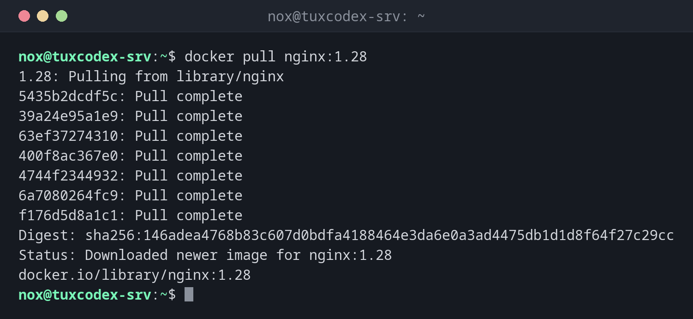

# docker pull

> Downloads an image from a registry, by default from Docker Hub.



## Syntax

```bash
docker pull [OPTIONS] NAME[:TAG]
```

## Options

| Option | Description |
|--------|-------------|
| `NAME` | Image name, such as `nginx` or `registry.example.com/nox/status-page` |
| `:TAG` | Version, such as `1.28`; without a tag, `latest` is used |
| `@sha256:…` | An exact image by its digest instead of a tag |
| `-a`, `--all-tags` | Download all tags of the image |
| `-q`, `--quiet` | Only print the name of the image |
| `--platform PLATFORM` | Another architecture, such as `linux/arm64` |

## Examples

**Download an image with a version tag:**

```bash
docker pull nginx:1.28
```

```text
1.28: Pulling from library/nginx
5435b2dcdf5c: Pull complete
39a24e95a1e9: Pull complete
63ef37274310: Pull complete
400f8ac367e0: Pull complete
4744f2344932: Pull complete
6a7080264fc9: Pull complete
f176d5d8a1c1: Pull complete
Digest: sha256:146adea4768b83c607d0bdfa4188464e3da6e0a3ad4475db1d1d8f64f27c29cc
Status: Downloaded newer image for nginx:1.28
docker.io/library/nginx:1.28
```

**The image is already up to date:**

```bash
docker pull nginx:1.28
```

```text
1.28: Pulling from library/nginx
Digest: sha256:146adea4768b83c607d0bdfa4188464e3da6e0a3ad4475db1d1d8f64f27c29cc
Status: Image is up to date for nginx:1.28
docker.io/library/nginx:1.28
```

**From your own registry:**

```bash
docker pull -q registry.example.com/nox/status-page:1.0
```

```text
registry.example.com/nox/status-page:1.0
```

**An image that doesn't exist:**

```bash
docker pull nginx:1.82
```

```text
Error response from daemon: failed to resolve reference "docker.io/library/nginx:1.82": docker.io/library/nginx:1.82: not found
```

## When do I need it?

- To get a new version of an image before you update a container
- To download images in advance, so that a later start doesn't have to wait
- To get the security updates that a new build of the same tag contains

!!! tip "Pull alone doesn't update anything"
    Running containers keep using the old image. Only when you create the container again
    (or run `docker compose up -d`) does it start from the new image.

!!! warning "Rate limits on Docker Hub"
    Docker Hub limits the number of pulls without an account per IP address. On servers
    that pull a lot, log in with `docker login` or use a mirror.

## Related commands

[docker images](docker-images.md) · [docker run](docker-run.md) · [docker push](docker-push.md) · [docker compose](docker-compose.md)
