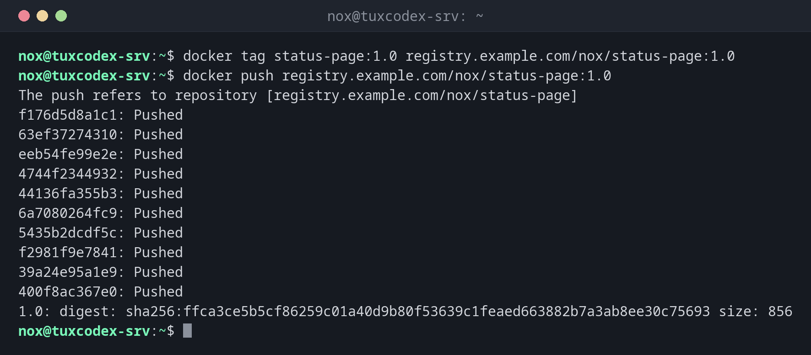

# docker push

> Uploads an image to a registry, such as Docker Hub, GitLab or your own registry.



## Syntax

```bash
docker push NAME[:TAG]
```

## Options

| Option | Description |
|--------|-------------|
| `NAME:TAG` | The image; the name must start with the address of the registry, such as `registry.example.com/nox/…` |
| `-a`, `--all-tags` | Push all tags of the image |
| `-q`, `--quiet` | Less output |

Before the first push, log in with `docker login registry.example.com`. `docker tag SOURCE TARGET` gives an existing image an additional name.

## Examples

**Give the image a name with the registry and push it:**

```bash
docker tag status-page:1.0 registry.example.com/nox/status-page:1.0
docker push registry.example.com/nox/status-page:1.0
```

```text
The push refers to repository [registry.example.com/nox/status-page]
f176d5d8a1c1: Pushed
63ef37274310: Pushed
eeb54fe99e2e: Pushed
4744f2344932: Pushed
44136fa355b3: Pushed
6a7080264fc9: Pushed
5435b2dcdf5c: Pushed
f2981f9e7841: Pushed
39a24e95a1e9: Pushed
400f8ac367e0: Pushed
1.0: digest: sha256:ffca3ce5b5cf86259c01a40d9b80f53639c1feaed663882b7a3ab8ee30c75693 size: 856
```

**Log in to the registry:**

```bash
docker login registry.example.com -u nox
```

```text
Password:

WARNING! Your credentials are stored unencrypted in '/home/nox/.docker/config.json'.
Configure a credential helper to remove this warning. See
https://docs.docker.com/go/credential-store/

Login Succeeded
```

**A new version: only the changed layer is uploaded:**

```bash
docker push registry.example.com/nox/status-page:1.1
```

```text
The push refers to repository [registry.example.com/nox/status-page]
f176d5d8a1c1: Layer already exists
63ef37274310: Layer already exists
4744f2344932: Layer already exists
6a7080264fc9: Layer already exists
5435b2dcdf5c: Layer already exists
39a24e95a1e9: Layer already exists
400f8ac367e0: Layer already exists
a8c51e2d7f93: Pushed
1.1: digest: sha256:807c3828e0a86c119b6fc13680f7d9e2c08b7a5e4f1d3c6b9a2e8f0d4c7b1a35 size: 856
```

**Without logging in first:**

```bash
docker push registry.example.com/nox/status-page:1.1
```

```text
The push refers to repository [registry.example.com/nox/status-page]
push access denied, repository does not exist or may require authorization: authorization failed: no basic auth credentials
```

## When do I need it?

- To make your own image available to other servers
- To publish a version from a CI/CD pipeline
- To keep a copy of an image that you build yourself

!!! tip "Push version tags, not only latest"
    Push every image with a fixed version, such as `1.1`. Then servers can choose exactly
    which version they run, and you can go back to the previous one.

!!! warning "Credentials on the server"
    `docker login` saves the access data in `~/.docker/config.json`, only base64-encoded by
    default. On servers that only pull, use a read-only access token.

## Related commands

[docker build](docker-build.md) · [docker pull](docker-pull.md) · [docker images](docker-images.md) · [docker rmi](docker-rmi.md)
