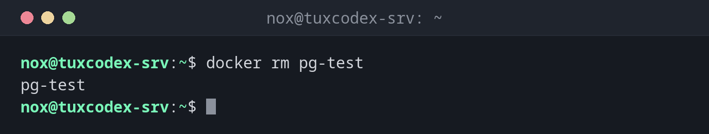

# docker rm

> Deletes stopped containers together with everything they wrote outside of volumes.



## Syntax

```bash
docker rm [-f] [-v] CONTAINER...
```

## Options

| Option | Description |
|--------|-------------|
| `CONTAINER` | Name or ID, several are possible |
| `-f`, `--force` | Also remove a running container (stops it with SIGKILL) |
| `-v`, `--volumes` | Also remove the anonymous volumes of the container |

`docker container prune` removes all stopped containers at once.

## Examples

**Remove a stopped container:**

```bash
docker rm pg-test
```

```text
pg-test
```

**A running container can't be removed:**

```bash
docker rm web
```

```text
Error response from daemon: cannot remove container "web": container is running: stop the container before removing or force remove
```

**Stop and remove in one step:**

```bash
docker rm -f web
```

```text
web
```

**Remove all stopped containers:**

```bash
docker container prune
```

```text
WARNING! This will remove all stopped containers.
Are you sure you want to continue? [y/N] y
Deleted Containers:
7b2e91c4d0a3c5f18e6d2b4a9f0c3e7d1b5a8f2c6e4d0b9a3f7c1e5d8b2a6f04

Total reclaimed space: 63B
```

## When do I need it?

- To clean up containers you no longer need
- To create a container again with different ports, volumes or variables
- After an image update: remove the old container and start a new one from the new image

!!! danger "Data outside volumes is lost"
    Everything a container wrote to its own file system disappears with `docker rm`. Check
    with `docker inspect -f "{{json .Mounts}}" CONTAINER` that the important data lies in a
    volume or a bind mount.

## Related commands

[docker stop](docker-stop.md) · [docker run](docker-run.md) · [docker rmi](docker-rmi.md) · [docker system](docker-system.md)
