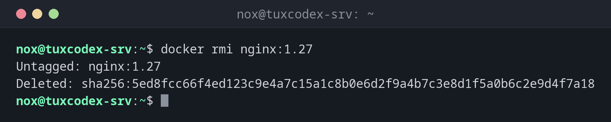

# docker rmi

> Löscht Images vom Host.



## Syntax

```bash
docker rmi [-f] IMAGE...
```

## Optionen

| Option | Beschreibung |
|--------|--------------|
| `IMAGE` | Name mit Tag oder ID; mehrere sind möglich |
| `-f`, `--force` | Auch ein Image löschen, das ein gestoppter Container nutzt oder das mehrere Namen hat |

`docker image prune` löscht alle Images ohne Namen, `docker image prune -a` alle Images, die kein Container nutzt.

## Beispiele

**Eine alte Version löschen:**

```bash
docker rmi nginx:1.27
```

```text
Untagged: nginx:1.27
Deleted: sha256:5ed8fcc66f4ed123c9e4a7c15a1c8b0e6d2f9a4b7c3e8d1f5a0b6c2e9d4f7a18
```

**Ein Image, das noch ein Container nutzt:**

```bash
docker rmi hello-world
```

```text
Error response from daemon: conflict: unable to delete hello-world:latest (must be forced) - container db7edd51542a is using its referenced image 11a3eb1597e8
```

**Nur einen zusätzlichen Namen entfernen:**

```bash
docker rmi registry.example.com/nox/status-page:1.0
```

```text
Untagged: registry.example.com/nox/status-page:1.0
```

**Alle Images ohne Container löschen:**

```bash
docker image prune -a -f
```

```text
Deleted Images:
untagged: status-page:1.0
deleted: sha256:ffca3ce5b5cf86259c01a40d9b80f53639c1feaed663882b7a3ab8ee30c75693
untagged: hello-world:latest
deleted: sha256:11a3eb1597e864c51b3f56733cb2e8a90bf0c284bfc05f9444d81c558bc848aa

Total reclaimed space: 237MB
```

## Wann brauche ich das?

- Nach einem Update, um die alte Version eines Images zu entfernen
- Wenn sich die Platte mit Images füllt
- Um ein Image erzwungen frisch herunterzuladen

!!! tip "Untagged oder gelöscht?"
    Hat ein Image mehrere Namen, entfernt `docker rmi NAME` nur diesen einen Namen
    (`Untagged`). Gelöscht (`Deleted`) werden die Daten erst, wenn der letzte Name weg ist.

## Verwandte Befehle

[docker images](docker-images.md) · [docker rm](docker-rm.md) · [docker system](docker-system.md) · [docker pull](docker-pull.md)
