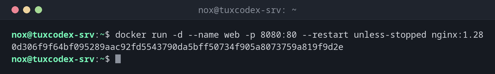

# docker run

> Creates a container from an image and starts it.



## Syntax

```bash
docker run [OPTIONS] IMAGE [COMMAND [ARG...]]
```

## Options

| Option | Description |
|--------|-------------|
| `-d`, `--detach` | Run in the background and print the container ID |
| `--name NAME` | Name of the container, otherwise Docker picks a random one |
| `-p HOST:CONTAINER` | Publish a port, such as `-p 8080:80` |
| `-v SOURCE:TARGET[:ro]` | Mount a volume or a host directory |
| `-e NAME=VALUE` | Set an environment variable |
| `--restart POLICY` | Restart automatically: `no`, `on-failure`, `always`, `unless-stopped` |
| `--rm` | Delete the container as soon as it stops |
| `-it` | Interactive with a terminal, for a shell in the container |
| `--network NAME` | Connect the container to this network |

## Examples

**Start nginx in the background:**

```bash
docker run -d --name web -p 8080:80 --restart unless-stopped nginx:1.28
```

```text
0d306f9f64bf095289aac92fd5543790da5bff50734f905a8073759a819f9d2e
```

The long string is the ID of the new container. nginx now answers on port 8080 of the server.

**A database with a volume for its data:**

```bash
docker run -d --name db -e POSTGRES_PASSWORD=secret \
  -v pgdata:/var/lib/postgresql/data postgres:17
```

```text
f1971ec6019cd6b63bec27e35dd69ceae4e9504716d98e74ba691b6989040cae
```

**Run a command once and remove the container:**

```bash
docker run --rm debian:trixie cat /etc/debian_version
```

```text
13.1
```

**A shell in a fresh container:**

```bash
docker run --rm -it ubuntu:24.04 bash
```

```text
root@5c1e8d3a7f20:/# cat /etc/lsb-release | tail -1
DISTRIB_DESCRIPTION="Ubuntu 24.04.3 LTS"
root@5c1e8d3a7f20:/# exit
```

`exit` ends the shell, and `--rm` deletes the container right away.

**The first run of an image downloads it:**

```bash
docker run hello-world
```

```text
Unable to find image 'hello-world:latest' locally
latest: Pulling from library/hello-world
4f55086f7dd0: Pull complete
Digest: sha256:11a3eb1597e864c51b3f56733cb2e8a90bf0c284bfc05f9444d81c558bc848aa
Status: Downloaded newer image for hello-world:latest

Hello from Docker!
This message shows that your installation appears to be working correctly.
...
```

## When do I need it?

- To start a service such as a web server or a database in a container
- To try out a tool or another distribution without installing anything
- To run a one-off job, such as a database dump, in a fresh container

!!! tip "Restart after a reboot"
    Without `--restart`, a container stays stopped after the server reboots. For services,
    use `--restart unless-stopped`.

!!! warning "Ports bypass the firewall"
    Ports published with `-p` are opened by Docker directly in the packet filter, past
    `ufw` and `firewalld` rules. Bind ports that only the host needs to localhost:
    `-p 127.0.0.1:5432:5432`.

## Related commands

[docker ps](docker-ps.md) · [docker logs](docker-logs.md) · [docker stop](docker-stop.md) · [docker compose](docker-compose.md)
