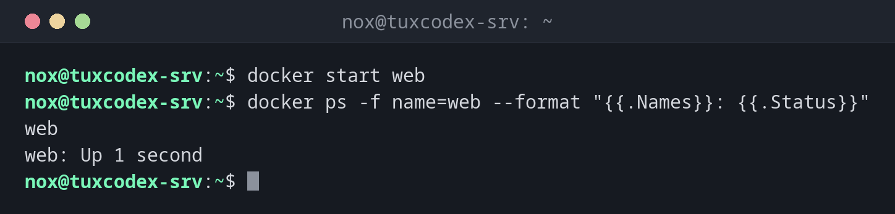

# docker start

> Startet einen oder mehrere gestoppte Container wieder, mit denselben Einstellungen wie vorher.



## Syntax

```bash
docker start [-a] [-i] CONTAINER...
```

## Optionen

| Option | Beschreibung |
|--------|--------------|
| `CONTAINER` | Name oder ID, mehrere sind möglich |
| `-a`, `--attach` | Verbunden bleiben und die Ausgabe zeigen |
| `-i`, `--interactive` | Die Tastatureingabe verbinden, für Container mit einer Shell |

Stoppen und Starten in einem Schritt erledigt `docker restart CONTAINER`.

## Beispiele

**Einen gestoppten Container starten:**

```bash
docker start web
docker ps -f name=web --format "{{.Names}}: {{.Status}}"
```

```text
web
web: Up 1 second
```

**Mehrere Container starten:**

```bash
docker start db web
```

```text
db
web
```

**Einen Container nach einer Änderung neu starten:**

```bash
docker restart web
```

```text
web
```

**Starten und die Ausgabe verfolgen:**

```bash
docker start -a pg-test
```

```text
PostgreSQL Database directory appears to contain a database; Skipping initialization

2026-10-26 09:42:17.312 UTC [1] LOG:  starting PostgreSQL 17.6 (Debian 17.6-1.pgdg13+1) on x86_64-pc-linux-gnu, compiled by gcc (Debian 14.2.0-19) 14.2.0, 64-bit
2026-10-26 09:42:17.313 UTC [1] LOG:  listening on IPv4 address "0.0.0.0", port 5432
2026-10-26 09:42:17.321 UTC [1] LOG:  database system is ready to accept connections
```

## Wann brauche ich das?

- Um einen gestoppten Container zurückzuholen, ohne ihn neu anzulegen
- Nach Wartungsarbeiten, für die du einen Dienst gestoppt hast
- Um einen Dienst nach einer Konfigurationsänderung mit `docker restart` neu zu starten

!!! tip "start behält die alten Einstellungen"
    Ports, Volumes und Umgebungsvariablen hat `docker run` festgelegt. Um sie zu ändern,
    entferne den Container und lege ihn neu an, oder ändere die `compose.yaml` und führe
    `docker compose up -d` aus.

## Verwandte Befehle

[docker stop](docker-stop.md) · [docker run](docker-run.md) · [docker ps](docker-ps.md) · [docker logs](docker-logs.md)
