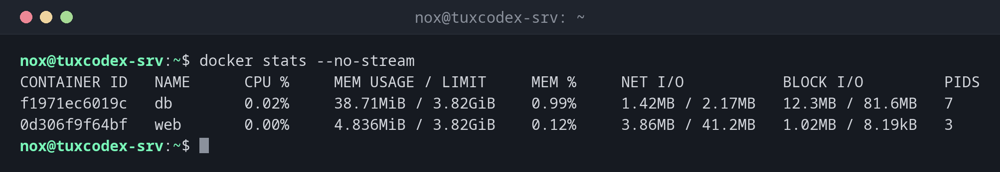

# docker stats

> Zeigt CPU-, Speicher-, Netzwerk- und Plattenauslastung der laufenden Container live an.



## Syntax

```bash
docker stats [OPTIONEN] [CONTAINER...]
```

## Optionen

| Option | Beschreibung |
|--------|--------------|
| `CONTAINER` | Nur diese Container, sonst alle laufenden |
| `--no-stream` | Die Werte einmal zeigen und beenden, statt sie zu aktualisieren |
| `-a`, `--all` | Auch gestoppte Container auflisten |
| `--format VORLAGE` | Die Spalten auswählen, etwa `"{{.Name}}\t{{.MemUsage}}"` |

## Beispiele

**Auslastung aller laufenden Container:**

```bash
docker stats --no-stream
```

```text
CONTAINER ID   NAME      CPU %     MEM USAGE / LIMIT     MEM %     NET I/O           BLOCK I/O         PIDS
f1971ec6019c   db        0.02%     38.71MiB / 3.82GiB    0.99%     1.42MB / 2.17MB   12.3MB / 81.6MB   7
0d306f9f64bf   web       0.00%     4.836MiB / 3.82GiB    0.12%     3.86MB / 41.2MB   1.02MB / 8.19kB   3
```

**Nur Name, CPU und Speicher:**

```bash
docker stats --no-stream --format "table {{.Name}}\t{{.CPUPerc}}\t{{.MemUsage}}"
```

```text
NAME      CPU %     MEM USAGE / LIMIT
db        0.02%     38.71MiB / 3.82GiB
web       0.00%     4.836MiB / 3.82GiB
```

**Ein Container mit Speicherlimit:**

```bash
docker stats --no-stream web
```

```text
CONTAINER ID   NAME      CPU %     MEM USAGE / LIMIT   MEM %     NET I/O           BLOCK I/O         PIDS
0d306f9f64bf   web       0.00%     4.84MiB / 256MiB    1.89%     3.86MB / 41.2MB   1.02MB / 8.19kB   3
```

## Wann brauche ich das?

- Wenn der Server langsam ist und du wissen willst, welcher Container dafür verantwortlich ist
- Um zu prüfen, ob ein Speicherlimit hoch genug gesetzt ist
- Für einen schnellen Überblick über die Last, ganz ohne Monitoring-System

!!! tip "Speicher begrenzen"
    Ein Container darf standardmäßig den gesamten Speicher des Hosts nutzen. Begrenze ihn mit
    `docker run -m 512m` oder `mem_limit: 512m` in der `compose.yaml`; die Spalte LIMIT zeigt
    dann diesen Wert.

## Verwandte Befehle

[docker ps](docker-ps.md) · [docker inspect](docker-inspect.md) · [top](../08-processes/top.md) · [docker system](docker-system.md)
