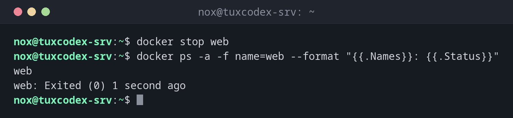

# docker stop

> Stoppt laufende Container sauber: zuerst mit SIGTERM, nach einer Wartezeit mit SIGKILL.



## Syntax

```bash
docker stop [-t SEKUNDEN] CONTAINER...
```

## Optionen

| Option | Beschreibung |
|--------|--------------|
| `CONTAINER` | Name oder ID, mehrere sind möglich |
| `-t`, `--timeout SEKUNDEN` | Wie lange vor SIGKILL gewartet wird (Standard 10) |
| `-s`, `--signal SIGNAL` | Statt SIGTERM ein anderes Signal senden |

`docker kill CONTAINER` stoppt sofort mit SIGKILL, ohne Wartezeit.

## Beispiele

**Einen Container stoppen:**

```bash
docker stop web
docker ps -a -f name=web --format "{{.Names}}: {{.Status}}"
```

```text
web
web: Exited (0) 1 second ago
```

**Einer Datenbank eine Minute geben:**

```bash
docker stop -t 60 db
```

```text
db
```

**Alle laufenden Container stoppen:**

```bash
docker stop $(docker ps -q)
```

```text
f1971ec6019c
0d306f9f64bf
```

**nginx die Konfiguration neu laden lassen, ohne zu stoppen:**

```bash
docker kill -s HUP web
```

```text
web
```

## Wann brauche ich das?

- Vor Wartungsarbeiten, einer Datensicherung oder einem Update des Hosts
- Um einen Dienst anzuhalten, der nicht mehr gebraucht wird
- Um vor einem Neustart alle Container zu stoppen: `docker stop $(docker ps -q)`

!!! tip "Datenbanken mehr Zeit geben"
    Datenbanken brauchen einen Moment, um ihre Daten sauber zu schreiben. Nimm für sie eine
    längere Wartezeit, etwa `docker stop -t 60 db`.

!!! warning "Restart-Regel und stop"
    Ein mit `docker stop` gestoppter Container bleibt gestoppt, auch mit `--restart always`,
    bis der Docker-Dienst selbst neu startet. Mit `unless-stopped` bleibt er auch nach einem
    Neustart gestoppt.

## Verwandte Befehle

[docker start](docker-start.md) · [docker rm](docker-rm.md) · [docker ps](docker-ps.md) · [docker compose](docker-compose.md)
