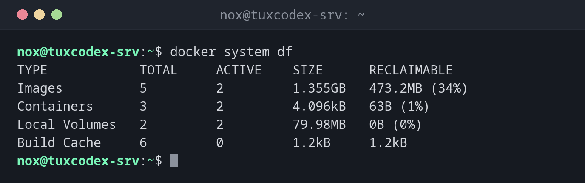

# docker system

> Shows how much space Docker uses and cleans up stopped containers, unused images, networks and build cache.



## Syntax

```bash
docker system df [-v]
docker system prune [-a] [--volumes] [-f]
docker system info
```

## Options

| Option | Description |
|--------|-------------|
| `df` | Space used by images, containers, volumes and build cache |
| `df -v` | The same, broken down per image, container and volume |
| `prune` | Delete stopped containers, unused networks, dangling images and build cache |
| `prune -a` | Also delete all images that no container uses |
| `prune --volumes` | Also delete unused anonymous volumes |
| `-f`, `--force` | Don't ask for confirmation |
| `info` | Overview of the Docker installation: version, storage driver, number of containers |

## Examples

**See how much space Docker uses:**

```bash
docker system df
```

```text
TYPE            TOTAL     ACTIVE    SIZE      RECLAIMABLE
Images          5         2         1.355GB   473.2MB (34%)
Containers      3         2         4.096kB   63B (1%)
Local Volumes   2         2         79.98MB   0B (0%)
Build Cache     6         0         1.2kB     1.2kB
```

RECLAIMABLE is what `docker system prune -a` could free.

**Clean up:**

```bash
docker system prune
```

```text
WARNING! This will remove:
  - all stopped containers
  - all networks not used by at least one container
  - all dangling images
  - unused build cache

Are you sure you want to continue? [y/N] y
Deleted Containers:
7b2e91c4d0a3c5f18e6d2b4a9f0c3e7d1b5a8f2c6e4d0b9a3f7c1e5d8b2a6f04

Deleted Networks:
backend

Deleted build cache objects:
wkc9ai887k3osdzs7fehpx8mq
vtck2exxroz70diuwiw6hluh8
4shp7pqvwo9swmcs9qtiaeeie

Total reclaimed space: 8.255kB
```

**Also remove all unused images, without asking:**

```bash
docker system prune -a -f
```

```text
Deleted Images:
untagged: nginx:1.27
deleted: sha256:5ed8fcc66f4ed123c9e4a7c15a1c8b0e6d2f9a4b7c3e8d1f5a0b6c2e9d4f7a18
untagged: status-page:1.0
deleted: sha256:ffca3ce5b5cf86259c01a40d9b80f53639c1feaed663882b7a3ab8ee30c75693

Total reclaimed space: 473.2MB
```

**Key facts of the installation:**

```bash
docker system info -f "{{.ServerVersion}}, {{.Driver}}, {{.Containers}} containers, {{.DockerRootDir}}"
```

```text
29.9.2, overlayfs, 3 containers, /var/lib/docker
```

## When do I need it?

- When `/var/lib/docker` is filling up the disk
- As a regular cleanup job on build servers
- To check the Docker installation and its settings

!!! tip "Clean up regularly"
    Every update leaves the old image behind. A weekly
    `docker image prune -a -f --filter until=168h` in a cron job removes images that have
    been unused for more than a week.

!!! warning "prune -a removes images of stopped stacks"
    `docker system prune -a` also deletes the images of containers that are just stopped.
    They will be downloaded again at the next start, which takes time and needs the registry
    to be reachable.

## Related commands

[docker images](docker-images.md) · [docker rmi](docker-rmi.md) · [docker volume](docker-volume.md) · [df](../13-disks-storage/df.md)
