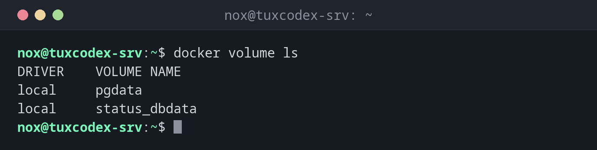

# docker volume

> Verwaltet Volumes: von Docker verwalteten Speicher, der Daten über die Lebensdauer eines Containers hinaus behält.



## Syntax

```bash
docker volume create | ls | inspect | rm | prune [NAME]
```

## Optionen

| Option | Beschreibung |
|--------|--------------|
| `create NAME` | Ein Volume anlegen (`docker run -v NAME:…` legt es auch automatisch an) |
| `ls` | Alle Volumes auflisten |
| `inspect NAME` | Details, auch das Verzeichnis auf dem Host (`Mountpoint`) |
| `rm NAME` | Ein Volume löschen, das kein Container nutzt |
| `prune` | Alle ungenutzten anonymen Volumes löschen; mit `-a` auch benannte |

## Beispiele

**Die Volumes auflisten:**

```bash
docker volume ls
```

```text
DRIVER    VOLUME NAME
local     pgdata
local     status_dbdata
```

**Ein Volume anlegen und nutzen:**

```bash
docker volume create pgdata
docker run -d --name db -e POSTGRES_PASSWORD=secret \
  -v pgdata:/var/lib/postgresql/data postgres:17
```

```text
pgdata
f1971ec6019cd6b63bec27e35dd69ceae4e9504716d98e74ba691b6989040cae
```

**Wo das Volume auf dem Host liegt:**

```bash
docker volume inspect pgdata
```

```text
[
    {
        "CreatedAt": "2026-10-26T07:41:04Z",
        "Driver": "local",
        "Labels": null,
        "Mountpoint": "/var/lib/docker/volumes/pgdata/_data",
        "Name": "pgdata",
        "Options": null,
        "Scope": "local"
    }
]
```

**Ein Volume löschen, das noch genutzt wird:**

```bash
docker volume rm pgdata
```

```text
Error response from daemon: remove pgdata: volume is in use - [f1971ec6019cd6b63bec27e35dd69ceae4e9504716d98e74ba691b6989040cae]
```

## Wann brauche ich das?

- Um die Daten von Datenbanken und Diensten über Updates des Containers hinweg zu sichern
- Um herauszufinden, wo ein Volume auf dem Host liegt, etwa für Backups
- Um Volumes von Containern aufzuräumen, die es nicht mehr gibt

!!! tip "Ein Volume sichern"
    Häng das Volume nur lesend in einen temporären Container ein und pack es:
    `docker run --rm -v pgdata:/data:ro -v /mnt/backup:/backup debian:trixie tar -czf /backup/pgdata.tar.gz -C /data .`
    Stoppe die Datenbank vorher oder nutze ihr eigenes Dump-Werkzeug.

!!! danger "prune löscht Daten"
    `docker volume prune -a` löscht jedes Volume, das in diesem Moment kein Container nutzt,
    auch das einer gerade gestoppten Datenbank. Prüf vorher mit `docker volume ls`.

## Verwandte Befehle

[docker run](docker-run.md) · [docker inspect](docker-inspect.md) · [docker compose](docker-compose.md) · [docker system](docker-system.md)
