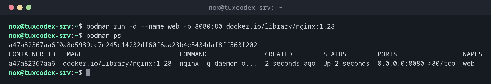

# podman

> Runs containers like Docker, but without a background service and also without root. On RHEL it is the standard container tool.



## Syntax

```bash
podman COMMAND [OPTIONS]
```

Almost all `docker` commands work the same way with `podman`: `podman run`, `podman ps`, `podman logs`, `podman build` and so on.

## Options

| Option | Description |
|--------|-------------|
| `run`, `ps`, `logs`, `exec`, `stop`, `rm` | Same as the `docker` commands of this chapter |
| `images`, `pull`, `build`, `push`, `rmi` | Same as with Docker |
| `pod create` | Create a pod: several containers that share a network, as in Kubernetes |
| `generate systemd` | Create a systemd unit for a container (deprecated, Quadlet is the successor) |
| `compose` | Run a `compose.yaml` (uses `podman-compose` or `docker-compose` in the background) |
| `auto-update` | Update containers whose image has a new version |

## Examples

**Start nginx as a normal user:**

```bash
podman run -d --name web -p 8080:80 docker.io/library/nginx:1.28
podman ps
```

```text
a47a82367aa6f0a8d5939cc7e245c14232df60f6aa23b4e5434daf8ff563f202
CONTAINER ID  IMAGE                         COMMAND               CREATED        STATUS        PORTS                 NAMES
a47a82367aa6  docker.io/library/nginx:1.28  nginx -g daemon o...  2 seconds ago  Up 2 seconds  0.0.0.0:8080->80/tcp  web
```

**Download an image:**

```bash
podman pull docker.io/library/postgres:17
```

```text
Trying to pull docker.io/library/postgres:17...
Getting image source signatures
Copying blob sha256:99b43abe6052d4e1c8f5a6b2e7d3c9f0a4b8e1d5c2f7a3b6e9d0c4f8a1b5e2d7
Copying blob sha256:bee16f784947a2c5e8d1f4b7a0c3e6d9f2b5a8c1e4d7f0a3b6c9e2d5f8a1b4c7
...
Copying config sha256:b8faeff7712663c2773a190181e1246e37e364b887611c04658c28b44e2408fe
Writing manifest to image destination
b8faeff7712663c2773a190181e1246e37e364b887611c04658c28b44e2408fe
```

**The images of your user:**

```bash
podman images
```

```text
REPOSITORY                  TAG         IMAGE ID      CREATED      SIZE
docker.io/library/postgres  17          b8faeff77126  3 weeks ago  465 MB
docker.io/library/nginx     1.28        fda7399e8104  6 weeks ago  164 MB
```

**A container as a systemd service with Quadlet:**

```bash
cat /etc/containers/systemd/web.container
sudo systemctl daemon-reload
sudo systemctl start web
systemctl is-active web
```

```text
[Container]
Image=docker.io/library/nginx:1.28
PublishPort=8080:80

[Install]
WantedBy=multi-user.target
active
```

## When do I need it?

- On RHEL, Rocky and Alma, where Docker isn't in the distribution
- When users should run containers without root rights and without the `docker` group
- To run containers as normal systemd services with Quadlet

!!! tip "Always use full image names"
    Use `docker.io/library/nginx:1.28` instead of `nginx:1.28`. Without a registry in the
    name, Podman asks which registry to use, or aborts with `short-name ... did not resolve`.

!!! tip "Quadlet instead of compose"
    A file `/etc/containers/systemd/web.container` with `[Container]`, `Image=` and
    `PublishPort=` becomes the systemd service `web.service` after `systemctl daemon-reload`.
    Then `systemctl start web` and `journalctl -u web` work as with any other service.

!!! warning "Rootless containers and low ports"
    Containers of a normal user can't open ports below 1024. Use a higher port such as
    `-p 8080:80`, or run the container as root.

## Distribution differences

| | Debian | Ubuntu | RHEL | Arch |
|---|--------|--------|------|------|
| Install | `sudo apt install podman` | `sudo apt install podman` | `sudo dnf install podman` | `sudo pacman -S podman` |
| Docker in the distribution | yes (`docker.io`) | yes (`docker.io`) | no, Podman is the default | yes (`docker`) |

## Related commands

[docker run](docker-run.md) · [docker compose](docker-compose.md) · [systemctl](../09-systemd/systemctl.md) · [docker ps](docker-ps.md)
