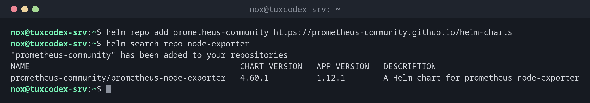

# helm

> The package manager for Kubernetes: installs ready-made applications (charts) with all their objects and updates them.



## Syntax

```bash
helm COMMAND [RELEASE] [CHART] [OPTIONS]
```

## Options

| Option | Description |
|--------|-------------|
| `repo add NAME URL`, `repo update` | Add a chart repository, update the lists |
| `search repo WORD` | Search the added repositories for charts |
| `install RELEASE CHART` | Install a chart under a name (the release) |
| `upgrade RELEASE CHART` | Update a release or change its values; `--install` also installs it |
| `-n NAMESPACE`, `--create-namespace` | Target namespace, create it if needed |
| `-f values.yaml`, `--set KEY=VALUE` | Own settings for the chart |
| `list -A` | Installed releases in all namespaces |
| `history`, `rollback RELEASE N` | Versions of a release, go back to version N |
| `uninstall RELEASE` | Remove a release with all its objects |
| `show values CHART` | The settings a chart offers |

## Examples

**Add a repository and search it:**

```bash
helm repo add prometheus-community https://prometheus-community.github.io/helm-charts
helm search repo node-exporter
```

```text
"prometheus-community" has been added to your repositories
NAME                                            CHART VERSION   APP VERSION   DESCRIPTION
prometheus-community/prometheus-node-exporter   4.60.1          1.12.1        A Helm chart for prometheus node-exporter
```

**Install a chart:**

```bash
helm install node-exporter prometheus-community/prometheus-node-exporter \
  -n monitoring --create-namespace
```

```text
NAME: node-exporter
LAST DEPLOYED: Mon Oct 26 10:42:17 2026
NAMESPACE: monitoring
STATUS: deployed
REVISION: 1
DESCRIPTION: Install complete
TEST SUITE: None
NOTES:
1. Get the application URL by running these commands:
  export POD_NAME=$(kubectl get pods --namespace monitoring -l "app.kubernetes.io/name=prometheus-node-exporter,app.kubernetes.io/instance=node-exporter" -o jsonpath="{.items[0].metadata.name}")
  echo "Visit http://127.0.0.1:9100 to use your application"
  kubectl port-forward --namespace monitoring $POD_NAME 9100
```

**The installed releases:**

```bash
helm list -A
```

```text
NAME            NAMESPACE     REVISION   UPDATED                                   STATUS     CHART                             APP VERSION
node-exporter   monitoring    1          2026-10-26 10:42:17.493561963 +0100 CET   deployed   prometheus-node-exporter-4.60.1   1.12.1
traefik         kube-system   1          2026-10-23 14:20:33.815172573 +0200 CEST  deployed   traefik-34.2.1+up34.2.0           v3.3.2
traefik-crd     kube-system   1          2026-10-23 14:20:32.450321194 +0200 CEST  deployed   traefik-crd-34.2.1+up34.2.0       v3.3.2
```

**Version history and going back:**

```bash
helm history node-exporter -n monitoring
helm rollback node-exporter 1 -n monitoring
```

```text
REVISION   UPDATED                    STATUS       CHART                             APP VERSION   DESCRIPTION
1          Mon Oct 26 10:42:17 2026   superseded   prometheus-node-exporter-4.60.1   1.12.1        Install complete
2          Mon Oct 26 10:44:03 2026   deployed     prometheus-node-exporter-4.60.1   1.12.1        Upgrade complete
Rollback was a success! Happy Helming!
```

**Remove a release:**

```bash
helm uninstall node-exporter -n monitoring
```

```text
release "node-exporter" uninstalled
```

## When do I need it?

- To install complex software such as monitoring, databases or ingress controllers with one command
- To update applications and keep your own settings in a `values.yaml`
- To go back to the previous version after a failed update

!!! tip "Keep your values in a file"
    Write your settings into a `values.yaml` and use
    `helm upgrade --install RELEASE CHART -f values.yaml`. The same command installs and
    updates, and the file can go into Git.

!!! warning "Pin the chart version"
    Without `--version`, Helm installs the newest chart, which may bring a new major version
    of the application. On production clusters, set `--version` explicitly.

## Distribution differences

| | Debian | Ubuntu | RHEL | Arch |
|---|--------|--------|------|------|
| Install | install script from helm.sh | install script from helm.sh, or `sudo snap install helm --classic` | install script from helm.sh | `sudo pacman -S helm` |

## Related commands

[kubectl apply](kubectl-apply.md) · [kubectl rollout](kubectl-rollout.md) · [kubectl port-forward](kubectl-port-forward.md) · [k9s](k9s.md)
