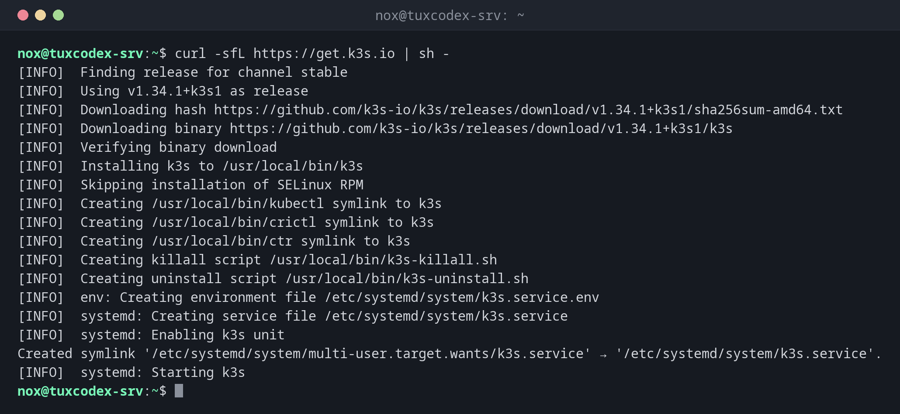

# k3s

> A complete Kubernetes distribution in a single binary, installed with one command and run as a systemd service.



## Syntax

```bash
curl -sfL https://get.k3s.io | [ENV=VALUE...] sh -s - [OPTIONS]
k3s COMMAND
```

## Options

| Option | Description |
|--------|-------------|
| `INSTALL_K3S_VERSION=v1.34.1+k3s1` | Install exactly this version instead of the newest stable one |
| `--write-kubeconfig-mode 644` | Make `/etc/rancher/k3s/k3s.yaml` readable for all users |
| `--disable traefik` | Don't install the included ingress controller Traefik |
| `K3S_URL=https://SERVER:6443`, `K3S_TOKEN=…` | Join an additional server as an agent node |
| `k3s kubectl`, `k3s crictl`, `k3s ctr` | The included tools (`kubectl`, `crictl` and `ctr` are also links to `k3s`) |
| `k3s check-config` | Check whether the kernel has everything k3s needs |
| `k3s-uninstall.sh` | Remove k3s completely, including all data |

The configuration can also be written to `/etc/rancher/k3s/config.yaml`, for example `write-kubeconfig-mode: "0644"`.

## Examples

**Install k3s:**

```bash
curl -sfL https://get.k3s.io | sh -
```

```text
[INFO]  Finding release for channel stable
[INFO]  Using v1.34.1+k3s1 as release
[INFO]  Downloading hash https://github.com/k3s-io/k3s/releases/download/v1.34.1+k3s1/sha256sum-amd64.txt
[INFO]  Downloading binary https://github.com/k3s-io/k3s/releases/download/v1.34.1+k3s1/k3s
[INFO]  Verifying binary download
[INFO]  Installing k3s to /usr/local/bin/k3s
[INFO]  Skipping installation of SELinux RPM
[INFO]  Creating /usr/local/bin/kubectl symlink to k3s
[INFO]  Creating /usr/local/bin/crictl symlink to k3s
[INFO]  Creating /usr/local/bin/ctr symlink to k3s
[INFO]  Creating killall script /usr/local/bin/k3s-killall.sh
[INFO]  Creating uninstall script /usr/local/bin/k3s-uninstall.sh
[INFO]  env: Creating environment file /etc/systemd/system/k3s.service.env
[INFO]  systemd: Creating service file /etc/systemd/system/k3s.service
[INFO]  systemd: Enabling k3s unit
Created symlink '/etc/systemd/system/multi-user.target.wants/k3s.service' → '/etc/systemd/system/k3s.service'.
[INFO]  systemd: Starting k3s
```

**Check the cluster:**

```bash
sudo kubectl get nodes -o wide
```

```text
NAME           STATUS   ROLES           AGE   VERSION        INTERNAL-IP   EXTERNAL-IP   OS-IMAGE                       KERNEL-VERSION        CONTAINER-RUNTIME
tuxcodex-srv   Ready    control-plane   2m    v1.34.1+k3s1   192.0.2.10    <none>        Debian GNU/Linux 13 (trixie)   6.12.48+deb13-amd64   containerd://2.1.4-k3s2
```

**The service and the version:**

```bash
systemctl is-active k3s
k3s --version
```

```text
active
k3s version v1.34.1+k3s1 (24fc436e)
go version go1.24.6
```

**The containers on the node, without Kubernetes:**

```bash
sudo k3s crictl ps
```

```text
CONTAINER           IMAGE               CREATED             STATE               NAME                     ATTEMPT             POD ID              POD                                       NAMESPACE
c55e2e4b44b11       fda7399e81045       2 hours ago         Running             nginx                    0                   b0ae7914d2596       web-9bc5f7f5b-8ptw2                       status
7074c9daf310f       fda7399e81045       2 hours ago         Running             nginx                    0                   279870aab17b8       web-9bc5f7f5b-m8l96                       status
4d4e184aa0d6c       3a1e150bf4c56       2 hours ago         Running             traefik                  0                   c5141082d8e70       traefik-6f986b958c-v9bwd                  kube-system
763d3fa5c629b       0392ee0389032       2 hours ago         Running             coredns                  0                   7d651a7e76583       coredns-7896679cc-2dcm2                   kube-system
```

`crictl` talks directly to containerd. It helps when `kubectl` itself doesn't respond.

**Add a second server as agent:**

```bash
sudo cat /var/lib/rancher/k3s/server/node-token
curl -sfL https://get.k3s.io | K3S_URL=https://192.0.2.10:6443 K3S_TOKEN=K10…::server:4f… sh -
```

```text
K10a3c1f6b9e2d4870c5f1e8a7b3d6c9f2e1a4b8d7c0f3e6a9b2d5c8f1e4a7b0d3c6::server:4f8e2b7a1c9d3e6f0a5b8c2d7e4f1a9b
[INFO]  Finding release for channel stable
[INFO]  Using v1.34.1+k3s1 as release
...
[INFO]  systemd: Starting k3s-agent
```

The first command runs on the existing server, the second on the new one.

## When do I need it?

- To set up a Kubernetes cluster on a single server for learning, testing or small services
- For small clusters, edge devices and homelabs, where a full Kubernetes would be too heavy
- To add more servers to an existing k3s cluster

!!! tip "What's included"
    k3s brings containerd, CoreDNS, Traefik as ingress, a load balancer for services, the
    metrics server and storage on the local disk. A fresh install is ready to use.

!!! warning "Updates"
    Running the install script again with a new `INSTALL_K3S_VERSION` updates k3s. Only
    update one minor version at a time (1.33 to 1.34, not 1.32 to 1.34) and read the
    release notes first.

## Distribution differences

| | Debian | Ubuntu | RHEL | Arch |
|---|--------|--------|------|------|
| SELinux | not used | not used | the script installs `k3s-selinux` | not used |
| Firewall for other machines | open 6443/tcp | `ufw allow 6443/tcp`, allow 10.42.0.0/16 and 10.43.0.0/16 | add 6443/tcp and the networks 10.42.0.0/16 and 10.43.0.0/16 to `firewalld`, or disable it | as configured |

## Related commands

[kubectl get](kubectl-get.md) · [kubectl config](kubectl-config.md) · [kubectl drain](kubectl-drain.md) · [systemctl](../09-systemd/systemctl.md)
