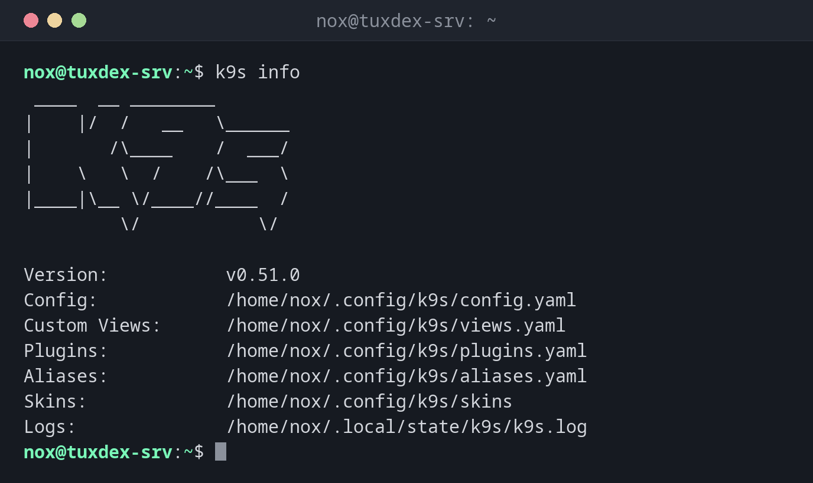

# k9s

> Eine interaktive Oberfläche im Terminal, um einen Kubernetes-Cluster zu beobachten und zu verwalten.



## Syntax

```bash
k9s [-n NAMESPACE] [--context NAME] [--readonly]
```

## Optionen

| Option | Beschreibung |
|--------|--------------|
| `-n NAMESPACE`, `-A` | In diesem Namespace starten oder in allen |
| `-c ANSICHT` | Startansicht, etwa `pods`, `deploy` oder `nodes` |
| `--context NAME` | Ein anderer Kontext aus der kubeconfig |
| `--readonly` | Alle Befehle abschalten, die etwas ändern |
| `info`, `version` | Die Pfade der Konfiguration oder die Version anzeigen |

Die wichtigsten Tasten in k9s:

| Taste | Aktion |
|-------|--------|
| `:pods`, `:deploy`, `:svc`, `:nodes`, `:ns` | Ansicht wechseln (wie `kubectl get`) |
| `/` | Die Liste filtern |
| ++enter++ | Das ausgewählte Objekt öffnen (Deployment → seine Pods) |
| `d` | Beschreiben (wie `kubectl describe`) |
| `l` | Die Logs zeigen |
| `s` | Eine Shell im Container öffnen |
| `shift+f` | Port-Weiterleitung |
| `ctrl+d` | Löschen (mit Rückfrage) |
| `?` | Hilfe mit allen Tasten |
| `:q`, ++ctrl+c++ | Beenden |

## Beispiele

**Version und Pfade der Konfiguration:**

```bash
k9s info
```

```text
 ____  __ ________
|    |/  /   __   \______
|       /\____    /  ___/
|    \   \  /    /\___  \
|____|\__ \/____//____  /
         \/           \/

Version:           v0.51.0
Config:            /home/nox/.config/k9s/config.yaml
Custom Views:      /home/nox/.config/k9s/views.yaml
Plugins:           /home/nox/.config/k9s/plugins.yaml
Aliases:           /home/nox/.config/k9s/aliases.yaml
Skins:             /home/nox/.config/k9s/skins
Logs:              /home/nox/.local/state/k9s/k9s.log
```

**Im Namespace der Statusseite starten:**

```bash
k9s -n status
```

```text
Context: default                                    <0> all       <a>      Attach     ____  __ ________
Cluster: default                                    <1> status    <ctrl-d> Delete    |    |/  /   __   \______
User:    default                                              <d>      Describe  |       /\____    /  ___/
K9s Rev: v0.51.0                                              <e>      Edit      |    \   \  /    /\___  \
K8s Rev: v1.34.1+k3s1                                         <l>      Logs      |____|\__ \/____//____  /
CPU:     11%                                                  <s>      Shell              \/           \/
MEM:     18%
┌──────────────────────────────────── Pods(status)[2] ────────────────────────────────────┐
│ NAME↑                  PF  READY  STATUS    RESTARTS  CPU  MEM  IP          NODE         │
│ web-9bc5f7f5b-8ptw2    ●   1/1    Running          0    3   12  10.42.0.9   tuxdex-srv │
│ web-9bc5f7f5b-m8l96    ●   1/1    Running          0    3   12  10.42.0.10  tuxdex-srv │
│                                                                                         │
└─────────────────────────────────────────────────────────────────────────────────────────┘
  <pod>
```

Die Liste aktualisiert sich von selbst. Die Tasten rechts hängen von der aktuellen Ansicht ab; `?` zeigt alle.

**Nur lesend, mit den Deployments als Start:**

```bash
k9s --readonly -c deploy -A
```

```text
┌────────────────────────────── Deployments(all)[5] ──────────────────────────────┐
│ NAMESPACE↑    NAME                      READY  UP-TO-DATE  AVAILABLE  AGE        │
│ kube-system   coredns                   1/1             1          1  3d         │
│ kube-system   local-path-provisioner    1/1             1          1  3d         │
│ kube-system   metrics-server            1/1             1          1  3d         │
│ kube-system   traefik                   1/1             1          1  3d         │
│ status        web                       2/2             2          2  2h         │
└─────────────────────────────────────────────────────────────────────────────────┘
```

## Wann brauche ich das?

- Um einen Cluster im Blick zu behalten, ohne immer wieder `kubectl get` zu tippen
- Um schnell von einem Deployment zu seinen Pods, deren Logs und einer Shell zu springen
- Für alle, die noch nicht jeden `kubectl`-Befehl auswendig kennen

!!! tip "Nur lesend zum Beobachten"
    `k9s --readonly` ist ideal für einen Bildschirm, der nur den Zustand des Clusters zeigt,
    oder für Kollegen, die schauen, aber nichts ändern sollen.

!!! warning "Dieselben Rechte wie kubectl"
    k9s nutzt deine kubeconfig. Was du mit `kubectl` darfst, erledigst du in k9s mit einer
    einzigen Taste, auch das Löschen von Objekten in der Produktion.

## Unterschiede zwischen Distributionen

| | Debian | Ubuntu | RHEL | Arch |
|---|--------|--------|------|------|
| Installation | `.deb` aus den k9s-Releases auf GitHub | `.deb` aus den k9s-Releases auf GitHub | `.rpm` aus den k9s-Releases auf GitHub | `sudo pacman -S k9s` |

## Verwandte Befehle

[kubectl get](kubectl-get.md) · [kubectl logs](kubectl-logs.md) · [kubectl config](kubectl-config.md) · [helm](helm.md)
