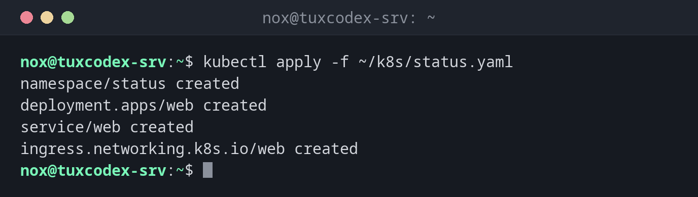

# kubectl apply

> Legt Objekte aus Manifest-Dateien an oder aktualisiert sie, damit der Cluster dem entspricht, was die Dateien beschreiben.



## Syntax

```bash
kubectl apply -f DATEI|VERZEICHNIS|URL [OPTIONEN]
```

## Optionen

| Option | Beschreibung |
|--------|--------------|
| `-f DATEI` | Manifest-Datei, ein Verzeichnis oder eine URL; `-f -` liest von der Standardeingabe |
| `-R`, `--recursive` | Auch die Unterverzeichnisse eines Verzeichnisses lesen |
| `-k VERZEICHNIS` | Ein Kustomize-Verzeichnis anwenden |
| `--dry-run=server` | Den Server alles prüfen lassen, ohne etwas zu ändern |
| `--prune -l LABEL` | Objekte mit diesem Label löschen, die nicht mehr in den Dateien stehen |

`kubectl diff -f DATEI` zeigt vorher, was `apply` ändern würde.

## Beispiele

**Die Statusseite ausrollen:**

```bash
kubectl apply -f ~/k8s/status.yaml
```

```text
namespace/status created
deployment.apps/web created
service/web created
ingress.networking.k8s.io/web created
```

Die Datei steht in den [Grundlagen](basics.md).

**Ohne Änderungen erneut anwenden:**

```bash
kubectl apply -f ~/k8s/status.yaml
```

```text
namespace/status unchanged
deployment.apps/web unchanged
service/web unchanged
ingress.networking.k8s.io/web unchanged
```

**Eine Änderung vor dem Anwenden ansehen:**

```bash
sed -i 's/replicas: 2/replicas: 3/' ~/k8s/status.yaml
kubectl diff -f ~/k8s/status.yaml
```

```text
diff -u -N /tmp/LIVE-1873412233/apps.v1.Deployment.status.web /tmp/MERGED-2201857604/apps.v1.Deployment.status.web
--- /tmp/LIVE-1873412233/apps.v1.Deployment.status.web  2026-10-26 10:42:17.000000000 +0100
+++ /tmp/MERGED-2201857604/apps.v1.Deployment.status.web  2026-10-26 10:42:17.000000000 +0100
@@ -6,7 +6,7 @@
   name: web
   namespace: status
 spec:
   progressDeadlineSeconds: 600
-  replicas: 2
+  replicas: 3
   revisionHistoryLimit: 10
   selector:
     matchLabels:
```

**Ein ganzes Verzeichnis anwenden:**

```bash
kubectl apply -R -f ~/k8s/
```

```text
namespace/status unchanged
deployment.apps/web configured
service/web unchanged
ingress.networking.k8s.io/web unchanged
configmap/web-config created
```

## Wann brauche ich das?

- Um eine in YAML-Dateien beschriebene Anwendung auszurollen
- Nach jeder Änderung an einem Manifest, etwa einer neuen Image-Version oder mehr Replikaten
- In Git-basierten Abläufen, in denen die Manifeste im Repository die Wahrheit sind

!!! tip "Manifeste in Git"
    Leg deine Manifeste in ein Git-Repository und ändere den Cluster nur mit
    `kubectl apply`. Dann zeigt der Verlauf jede Änderung, und ein Cluster lässt sich
    jederzeit aus den Dateien neu aufbauen.

!!! warning "Handänderungen werden überschrieben"
    Was du mit `kubectl edit` oder `kubectl scale` geändert hast, setzt das nächste
    `kubectl apply` wieder auf den Stand der Datei zurück. Ändere lieber die Datei.

## Verwandte Befehle

[kubectl create](kubectl-create.md) · [kubectl delete](kubectl-delete.md) · [kubectl rollout](kubectl-rollout.md) · [git diff](../18-git/git-diff.md)
