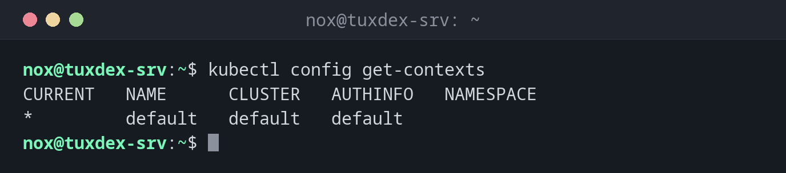

# kubectl config

> Shows and changes the kubeconfig: which clusters kubectl knows, which one is active and which namespace is the default.



## Syntax

```bash
kubectl config SUBCOMMAND [OPTIONS]
```

## Options

| Option | Description |
|--------|-------------|
| `view` | Show the configuration (keys are hidden) |
| `get-contexts` | List all contexts (cluster, user, namespace); `*` marks the active one |
| `current-context` | Show the active context |
| `use-context NAME` | Switch to another cluster |
| `set-context --current --namespace=NS` | Set the default namespace of the active context |
| `rename-context OLD NEW` | Give a context a better name |
| `--kubeconfig FILE` | Use another file (also works with every other `kubectl` command) |

## Examples

**List the contexts:**

```bash
kubectl config get-contexts
```

```text
CURRENT   NAME      CLUSTER   AUTHINFO   NAMESPACE
*         default   default   default
```

**Show the configuration:**

```bash
kubectl config view
```

```text
apiVersion: v1
clusters:
- cluster:
    certificate-authority-data: DATA+OMITTED
    server: https://127.0.0.1:6443
  name: default
contexts:
- context:
    cluster: default
    user: default
  name: default
current-context: default
kind: Config
users:
- name: default
  user:
    client-certificate-data: DATA+OMITTED
    client-key-data: DATA+OMITTED
```

**Make status the default namespace:**

```bash
kubectl config set-context --current --namespace=status
kubectl get pods
```

```text
Context "default" modified.
NAME                  READY   STATUS    RESTARTS   AGE
web-9bc5f7f5b-8ptw2   1/1     Running   0          2h
web-9bc5f7f5b-m8l96   1/1     Running   0          2h
```

**Give the context a clear name:**

```bash
kubectl config rename-context default tuxdex-srv
kubectl config current-context
```

```text
Context "default" renamed to "tuxdex-srv".
tuxdex-srv
```

## When do I need it?

- To check which cluster you're talking to before you change anything
- To switch between the test and the production cluster
- To save typing `-n status` with every command

!!! tip "Several files at once"
    `KUBECONFIG=~/.kube/config:~/.kube/prod.yaml` combines several files. `kubectl config
    view --flatten` writes them as one.

!!! warning "Know where you are"
    A command meant for the test cluster can hit production if the wrong context is
    active. Give contexts clear names (`rename-context default tuxdex-srv`) and check with
    `kubectl config current-context`.

## Distribution differences

| | Debian | Ubuntu | RHEL | Arch |
|---|--------|--------|------|------|
| kubectl | included in k3s; otherwise repository `pkgs.k8s.io`, then `sudo apt install kubectl` | included in k3s; otherwise repository `pkgs.k8s.io` or `sudo snap install kubectl --classic` | included in k3s; otherwise repository `pkgs.k8s.io`, then `sudo dnf install kubectl` | included in k3s; otherwise `sudo pacman -S kubectl` |

## Related commands

[kubectl get](kubectl-get.md) · [k3s](k3s.md) · [k9s](k9s.md)
