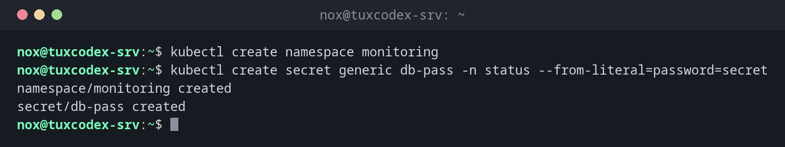

# kubectl create

> Creates a single object directly on the command line, such as a namespace, a secret or a deployment.



## Syntax

```bash
kubectl create TYPE NAME [OPTIONS]
```

## Options

| Option | Description |
|--------|-------------|
| `namespace NAME` | Create a namespace |
| `deployment NAME --image=IMAGE` | Create a deployment, with `--replicas=N` |
| `secret generic NAME --from-literal=KEY=VALUE` | Create a secret, also `--from-file=FILE` |
| `configmap NAME --from-file=FILE` | Create a ConfigMap from a file |
| `job NAME --image=IMAGE -- COMMAND` | Run a command once |
| `--dry-run=client -o yaml` | Don't create anything, only print the manifest |
| `-f FILE` | Create from a manifest (fails if the object exists, unlike `apply`) |

## Examples

**Create a namespace and a secret:**

```bash
kubectl create namespace monitoring
kubectl create secret generic db-pass -n status --from-literal=password=secret
```

```text
namespace/monitoring created
secret/db-pass created
```

**Generate a manifest instead of creating the object:**

```bash
kubectl create deployment hello --image=nginx:1.28 --dry-run=client -o yaml
```

```text
apiVersion: apps/v1
kind: Deployment
metadata:
  labels:
    app: hello
  name: hello
spec:
  replicas: 1
  selector:
    matchLabels:
      app: hello
  strategy: {}
  template:
    metadata:
      labels:
        app: hello
    spec:
      containers:
      - image: nginx:1.28
        name: nginx
        resources: {}
status: {}
```

**A configuration file as ConfigMap:**

```bash
kubectl create configmap web-config -n status --from-file=default.conf
```

```text
configmap/web-config created
```

**The object already exists:**

```bash
kubectl create namespace status
```

```text
Error from server (AlreadyExists): namespaces "status" already exists
```

## When do I need it?

- For quick tests that don't need a manifest
- To create secrets without writing passwords into a YAML file
- To get a starting point for a manifest with `--dry-run=client -o yaml`

!!! tip "Generate manifests"
    `kubectl create deployment … --dry-run=client -o yaml > deploy.yaml` writes a complete
    manifest that you can adjust and then roll out with `kubectl apply`.

!!! warning "Secrets are only base64"
    A secret is stored base64-encoded, not encrypted. Anyone allowed to read secrets in the
    namespace can decode it with `base64 -d`. Restrict access with RBAC.

## Related commands

[kubectl apply](kubectl-apply.md) · [kubectl delete](kubectl-delete.md) · [kubectl get](kubectl-get.md) · [kubectl describe](kubectl-describe.md)
