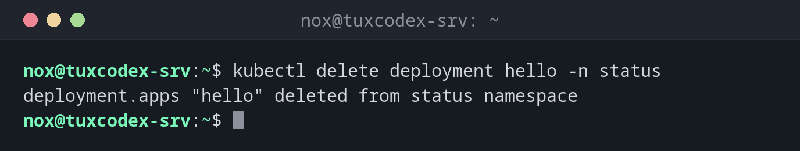

# kubectl delete

> Deletes objects from the cluster, by name, by label or as described in a manifest.



## Syntax

```bash
kubectl delete TYPE NAME | -f FILE | -l LABEL [OPTIONS]
```

## Options

| Option | Description |
|--------|-------------|
| `TYPE NAME` | Such as `pod broken` or `deployment hello` |
| `-f FILE` | Delete everything that the manifest describes |
| `-l LABEL=VALUE` | All objects with this label |
| `-n NAMESPACE` | Namespace of the objects |
| `--dry-run=client` | Only show what would be deleted |
| `--grace-period=0 --force` | Delete a hanging pod immediately |

## Examples

**Delete a deployment:**

```bash
kubectl delete deployment hello -n status
```

```text
deployment.apps "hello" deleted from status namespace
```

**Have a pod replaced:**

```bash
kubectl delete pod web-9bc5f7f5b-8ptw2 -n status
kubectl get pods -n status
```

```text
pod "web-9bc5f7f5b-8ptw2" deleted from status namespace
NAME                  READY   STATUS    RESTARTS   AGE
web-9bc5f7f5b-m8l96   1/1     Running   0          2h
web-9bc5f7f5b-q4zxn   1/1     Running   0          3s
```

**Check first what would be deleted:**

```bash
kubectl delete -f ~/k8s/status.yaml --dry-run=client
```

```text
namespace "status" deleted (dry run)
deployment.apps "web" deleted (dry run)
service "web" deleted (dry run)
ingress.networking.k8s.io "web" deleted (dry run)
```

**Remove a namespace with everything in it:**

```bash
kubectl delete namespace monitoring
```

```text
namespace "monitoring" deleted
```

## When do I need it?

- To remove test objects and applications you no longer need
- To have a hanging pod replaced: the deployment starts a new one right away
- To remove a whole application together with its namespace

!!! tip "Deleting a pod restarts it"
    A pod that belongs to a deployment is recreated immediately after `kubectl delete pod`.
    That's a quick way to restart a single pod. For all pods, use `kubectl rollout restart`.

!!! danger "A namespace takes everything with it"
    `kubectl delete namespace NAME` deletes every object in it, including secrets and
    volumes with their data, without asking.

## Related commands

[kubectl apply](kubectl-apply.md) · [kubectl create](kubectl-create.md) · [kubectl rollout](kubectl-rollout.md) · [kubectl get](kubectl-get.md)
