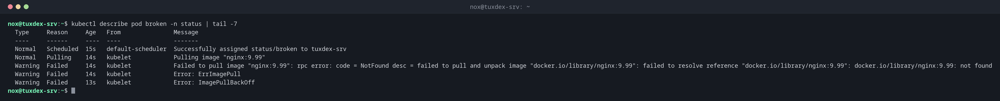

# kubectl describe

> Shows an object in detail, in readable form and with the latest events.



## Syntax

```bash
kubectl describe TYPE NAME [-n NAMESPACE]
```

## Options

| Option | Description |
|--------|-------------|
| `TYPE NAME` | Such as `pod web-9bc5f7f5b-8ptw2`, `deploy web` or `node tuxdex-srv` |
| `TYPE/NAME` | The same, written in one word |
| `-n NAMESPACE` | Namespace of the object |
| `-l LABEL=VALUE` | Describe all objects with this label |

## Examples

**Why doesn't the pod start? The events at the end:**

```bash
kubectl describe pod broken -n status | tail -7
```

```text
  Type     Reason     Age   From               Message
  ----     ------     ----  ----               -------
  Normal   Scheduled  15s   default-scheduler  Successfully assigned status/broken to tuxdex-srv
  Normal   Pulling    14s   kubelet            Pulling image "nginx:9.99"
  Warning  Failed     14s   kubelet            Failed to pull image "nginx:9.99": rpc error: code = NotFound desc = failed to pull and unpack image "docker.io/library/nginx:9.99": failed to resolve reference "docker.io/library/nginx:9.99": docker.io/library/nginx:9.99: not found
  Warning  Failed     14s   kubelet            Error: ErrImagePull
  Warning  Failed     13s   kubelet            Error: ImagePullBackOff
```

**The details of a running pod:**

```bash
kubectl describe pod web-9bc5f7f5b-8ptw2 -n status | head -32
```

```text
Name:             web-9bc5f7f5b-8ptw2
Namespace:        status
Priority:         0
Service Account:  default
Node:             tuxdex-srv/192.0.2.10
Start Time:       Mon, 26 Oct 2026 08:41:13 +0100
Labels:           app=web
                  pod-template-hash=9bc5f7f5b
Annotations:      <none>
Status:           Running
IP:               10.42.0.9
IPs:
  IP:           10.42.0.9
Controlled By:  ReplicaSet/web-9bc5f7f5b
Containers:
  nginx:
    Container ID:   containerd://8766fd32b309448bd25f9ef07d6576cd2ed7977cc53b04e7f8345a0adcea261a
    Image:          nginx:1.28
    Image ID:       docker.io/library/nginx@sha256:146adea4768b83c607d0bdfa4188464e3da6e0a3ad4475db1d1d8f64f27c29cc
    Port:           80/TCP
    Host Port:      0/TCP
    State:          Running
      Started:      Mon, 26 Oct 2026 08:41:20 +0100
    Ready:          True
    Restart Count:  0
    Limits:
      memory:  128Mi
    Requests:
      cpu:        50m
      memory:     32Mi
    Environment:  <none>
    Mounts:
      /var/run/secrets/kubernetes.io/serviceaccount from kube-api-access-bzr2s (ro)
```

**Reserved resources of a node:**

```bash
kubectl describe node tuxdex-srv | grep -A 7 'Allocated resources'
```

```text
Allocated resources:
  (Total limits may be over 100 percent, i.e., overcommitted.)
  Resource           Requests    Limits
  --------           --------    ------
  cpu                300m (15%)  0 (0%)
  memory             204Mi (5%)  426Mi (11%)
  ephemeral-storage  0 (0%)      0 (0%)
  hugepages-1Gi      0 (0%)      0 (0%)
```

## When do I need it?

- When a pod hangs in `Pending`, `ContainerCreating` or `ImagePullBackOff`
- To see which image, resources and volumes a pod actually has
- To check how much CPU and memory is reserved on a node

!!! tip "Read the Events first"
    The section `Events` at the end usually answers the question: image not found, not
    enough memory on the node, a volume that can't be mounted.

## Related commands

[kubectl get](kubectl-get.md) · [kubectl events](kubectl-events.md) · [kubectl logs](kubectl-logs.md) · [kubectl top](kubectl-top.md)
