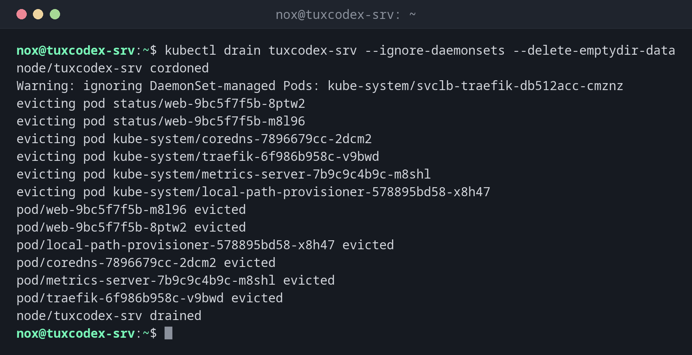

# kubectl drain

> Leert einen Node vor einer Wartung: keine neuen Pods mehr, und die laufenden ziehen auf andere Nodes um.



## Syntax

```bash
kubectl drain NODE [OPTIONEN]
kubectl cordon | uncordon NODE
```

## Optionen

| Option | Beschreibung |
|--------|--------------|
| `cordon NODE` | Nur verhindern, dass neue Pods auf dem Node landen |
| `drain NODE` | Sperren, dann alle Pods verdrängen |
| `--ignore-daemonsets` | Pods von DaemonSets lassen, die ohnehin auf jedem Node laufen |
| `--delete-emptydir-data` | Auch Pods mit temporären `emptyDir`-Volumes verdrängen (deren Daten gehen verloren) |
| `--force` | Auch Pods löschen, die zu keinem Deployment oder Ähnlichem gehören |
| `--timeout=5m` | Nach dieser Zeit aufgeben |
| `uncordon NODE` | Nach der Wartung wieder Pods auf dem Node zulassen |

## Beispiele

**Einen Node vor der Wartung leeren:**

```bash
kubectl drain tuxcodex-srv --ignore-daemonsets --delete-emptydir-data
```

```text
node/tuxcodex-srv cordoned
Warning: ignoring DaemonSet-managed Pods: kube-system/svclb-traefik-db512acc-cmznz
evicting pod status/web-9bc5f7f5b-8ptw2
evicting pod status/web-9bc5f7f5b-m8l96
evicting pod kube-system/coredns-7896679cc-2dcm2
evicting pod kube-system/traefik-6f986b958c-v9bwd
evicting pod kube-system/metrics-server-7b9c9c4b9c-m8shl
evicting pod kube-system/local-path-provisioner-578895bd58-x8h47
pod/web-9bc5f7f5b-m8l96 evicted
pod/web-9bc5f7f5b-8ptw2 evicted
pod/local-path-provisioner-578895bd58-x8h47 evicted
pod/coredns-7896679cc-2dcm2 evicted
pod/metrics-server-7b9c9c4b9c-m8shl evicted
pod/traefik-6f986b958c-v9bwd evicted
node/tuxcodex-srv drained
```

**Der Node ist für neue Pods gesperrt:**

```bash
kubectl get nodes
```

```text
NAME           STATUS                     ROLES           AGE   VERSION
tuxcodex-srv   Ready,SchedulingDisabled   control-plane   3d    v1.34.1+k3s1
```

**Ein Pod ohne Controller blockiert den Drain:**

```bash
kubectl drain tuxcodex-srv --ignore-daemonsets
```

```text
node/tuxcodex-srv already cordoned
error: unable to drain node "tuxcodex-srv" due to error: cannot delete cannot delete Pods that declare no controller (use --force to override): status/broken, continuing command...
There are pending nodes to be drained:
 tuxcodex-srv
cannot delete cannot delete Pods that declare no controller (use --force to override): status/broken
```

**Den Node nach der Wartung freigeben:**

```bash
kubectl uncordon tuxcodex-srv
```

```text
node/tuxcodex-srv uncordoned
```

## Wann brauche ich das?

- Bevor du einen Node aktualisierst oder neu startest
- Bevor du einen Node aus dem Cluster entfernst
- Um herauszufinden, welche Pods sich nicht verschieben lassen

!!! tip "Ablauf für ein Kernel-Update"
    `kubectl drain NODE --ignore-daemonsets`, dann den Server aktualisieren und neu
    starten, dann `kubectl uncordon NODE`. In einem Cluster mit mehreren Nodes laufen die
    Anwendungen dabei weiter.

!!! warning "Ein Node: drain heißt Ausfall"
    Mit nur einem Node gibt es keinen Ort, an den die Pods umziehen können. Sie stehen bis
    zum `kubectl uncordon`, auf `tuxcodex-srv` ist drain also ein geplanter Ausfall.

## Verwandte Befehle

[kubectl get](kubectl-get.md) · [k3s](k3s.md) · [kubectl describe](kubectl-describe.md) · [reboot](../09-systemd/reboot.md)
