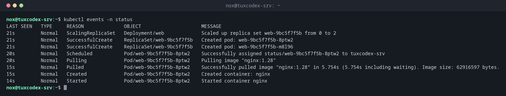

# kubectl events

> Zeigt, was im Cluster passiert ist: Pods eingeplant, Images geladen, Container gestartet, Fehler.



## Syntax

```bash
kubectl events [-n NAMESPACE | -A] [OPTIONEN]
```

## Optionen

| Option | Beschreibung |
|--------|--------------|
| `-n NAMESPACE` | Events dieses Namespaces |
| `-A`, `--all-namespaces` | Events aller Namespaces |
| `--for TYP/NAME` | Nur Events eines Objekts, etwa `--for pod/broken` |
| `--types=Warning` | Nur Warnungen |
| `-w`, `--watch` | Neue Events fortlaufend zeigen |

## Beispiele

**Was in einem Namespace passiert ist:**

```bash
kubectl events -n status
```

```text
LAST SEEN   TYPE     REASON              OBJECT                     MESSAGE
21s         Normal   ScalingReplicaSet   Deployment/web             Scaled up replica set web-9bc5f7f5b from 0 to 2
21s         Normal   SuccessfulCreate    ReplicaSet/web-9bc5f7f5b   Created pod: web-9bc5f7f5b-8ptw2
21s         Normal   SuccessfulCreate    ReplicaSet/web-9bc5f7f5b   Created pod: web-9bc5f7f5b-m8l96
20s         Normal   Scheduled           Pod/web-9bc5f7f5b-8ptw2    Successfully assigned status/web-9bc5f7f5b-8ptw2 to tuxcodex-srv
20s         Normal   Pulling             Pod/web-9bc5f7f5b-8ptw2    Pulling image "nginx:1.28"
15s         Normal   Pulled              Pod/web-9bc5f7f5b-8ptw2    Successfully pulled image "nginx:1.28" in 5.754s (5.754s including waiting). Image size: 62916597 bytes.
15s         Normal   Created             Pod/web-9bc5f7f5b-8ptw2    Created container: nginx
14s         Normal   Started             Pod/web-9bc5f7f5b-8ptw2    Started container nginx
```

**Nur Warnungen, im ganzen Cluster:**

```bash
kubectl events -A --types=Warning
```

```text
NAMESPACE   LAST SEEN   TYPE      REASON   OBJECT       MESSAGE
status      45s         Warning   Failed   Pod/broken   Failed to pull image "nginx:9.99": rpc error: code = NotFound desc = failed to pull and unpack image "docker.io/library/nginx:9.99": failed to resolve reference "docker.io/library/nginx:9.99": docker.io/library/nginx:9.99: not found
status      45s         Warning   Failed   Pod/broken   Error: ErrImagePull
status      44s         Warning   Failed   Pod/broken   Error: ImagePullBackOff
```

**Events eines Objekts:**

```bash
kubectl events -n status --for deployment/web
```

```text
LAST SEEN   TYPE     REASON              OBJECT           MESSAGE
5m          Normal   ScalingReplicaSet   Deployment/web   Scaled up replica set web-9bc5f7f5b from 2 to 3
3m          Normal   ScalingReplicaSet   Deployment/web   Scaled up replica set web-754948957d from 0 to 1
3m          Normal   ScalingReplicaSet   Deployment/web   Scaled down replica set web-9bc5f7f5b from 3 to 2
```

## Wann brauche ich das?

- Direkt nach `kubectl apply`, um zu sehen, ob alles startet
- Um im ganzen Cluster Warnungen zu finden, etwa fehlgeschlagene Image-Downloads oder volle Platten
- Wenn ein Pod verschwunden ist und du wissen willst, warum

!!! tip "Events halten nicht lange"
    Kubernetes hebt Events standardmäßig etwa eine Stunde auf. Für ältere Probleme schau in
    die Logs des Nodes mit `journalctl -u k3s`.

## Verwandte Befehle

[kubectl describe](kubectl-describe.md) · [kubectl get](kubectl-get.md) · [kubectl logs](kubectl-logs.md) · [journalctl](../09-systemd/journalctl.md)
