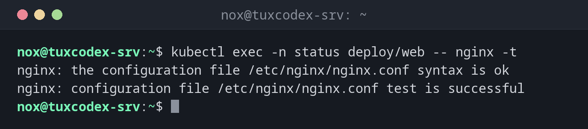

# kubectl exec

> Runs a command in a container of a running pod, for example a shell.



## Syntax

```bash
kubectl exec [-it] POD | TYPE/NAME [-c CONTAINER] -- COMMAND [ARG...]
```

## Options

| Option | Description |
|--------|-------------|
| `POD`, `deploy/NAME` | A pod, or a pod of this deployment |
| `-it` | Interactive with a terminal, needed for a shell |
| `-c CONTAINER` | Container in a pod with several containers |
| `-n NAMESPACE` | Namespace |
| `--` | Everything after it is the command in the container |

## Examples

**Test the nginx configuration:**

```bash
kubectl exec -n status deploy/web -- nginx -t
```

```text
nginx: the configuration file /etc/nginx/nginx.conf syntax is ok
nginx: configuration file /etc/nginx/nginx.conf test is successful
```

**A shell in the pod:**

```bash
kubectl exec -it -n status web-9bc5f7f5b-8ptw2 -- bash
```

```text
root@web-9bc5f7f5b-8ptw2:/# hostname -i
10.42.0.9
root@web-9bc5f7f5b-8ptw2:/# exit
```

**Check that the service resolves in the cluster:**

```bash
kubectl exec -n status deploy/web -- getent hosts web.status.svc.cluster.local
```

```text
10.43.196.168   web.status.svc.cluster.local
```

## When do I need it?

- To look around in a pod when something doesn't work
- To test the configuration or the network from inside a pod
- To run maintenance commands, such as a database migration

!!! tip "No shell in the image?"
    Minimal images often have no shell at all. `kubectl debug -it POD --image=busybox
    --target=CONTAINER` starts a helper container with tools in the same pod.

!!! warning "Changes are temporary"
    Whatever you change in a pod is lost as soon as the pod is replaced, which happens with
    every update. Lasting changes belong in the image or the manifest.

## Related commands

[kubectl logs](kubectl-logs.md) · [kubectl port-forward](kubectl-port-forward.md) · [kubectl describe](kubectl-describe.md) · [docker exec](../19-docker/docker-exec.md)
