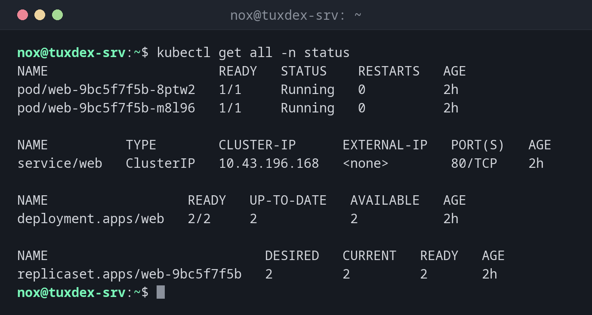

# kubectl get

> Listet Objekte im Cluster auf: Nodes, Pods, Deployments, Services und alles andere.



## Syntax

```bash
kubectl get TYP [NAME] [OPTIONEN]
```

## Optionen

| Option | Beschreibung |
|--------|--------------|
| `TYP` | Objekttyp, etwa `pods` (`po`), `deployments` (`deploy`), `services` (`svc`), `nodes` (`no`), `all` |
| `-n NAMESPACE` | In diesem Namespace statt im Standard-Namespace |
| `-A`, `--all-namespaces` | In allen Namespaces |
| `-o wide` | Mehr Spalten, etwa Node und IP-Adresse |
| `-o yaml`, `-o json` | Das vollständige Objekt |
| `-l LABEL=WERT` | Nur Objekte mit diesem Label |
| `-w`, `--watch` | Fortlaufend auf Änderungen achten |

## Beispiele

**Alles in einem Namespace:**

```bash
kubectl get all -n status
```

```text
NAME                      READY   STATUS    RESTARTS   AGE
pod/web-9bc5f7f5b-8ptw2   1/1     Running   0          2h
pod/web-9bc5f7f5b-m8l96   1/1     Running   0          2h

NAME          TYPE        CLUSTER-IP      EXTERNAL-IP   PORT(S)   AGE
service/web   ClusterIP   10.43.196.168   <none>        80/TCP    2h

NAME                  READY   UP-TO-DATE   AVAILABLE   AGE
deployment.apps/web   2/2     2            2           2h

NAME                            DESIRED   CURRENT   READY   AGE
replicaset.apps/web-9bc5f7f5b   2         2         2       2h
```

**Alle Pods im Cluster:**

```bash
kubectl get pods -A
```

```text
NAMESPACE     NAME                                      READY   STATUS      RESTARTS   AGE
kube-system   coredns-7896679cc-2dcm2                   1/1     Running     0          3d
kube-system   helm-install-traefik-2tbp6                0/1     Completed   1          3d
kube-system   helm-install-traefik-crd-9n8mf            0/1     Completed   0          3d
kube-system   local-path-provisioner-578895bd58-x8h47   1/1     Running     0          3d
kube-system   metrics-server-7b9c9c4b9c-m8shl           1/1     Running     0          3d
kube-system   svclb-traefik-db512acc-cmznz              2/2     Running     0          3d
kube-system   traefik-6f986b958c-v9bwd                  1/1     Running     0          3d
status        web-9bc5f7f5b-8ptw2                       1/1     Running     0          2h
status        web-9bc5f7f5b-m8l96                       1/1     Running     0          2h
```

**Pods mit Node und IP-Adresse:**

```bash
kubectl get pods -n status -o wide
```

```text
NAME                  READY   STATUS    RESTARTS   AGE   IP           NODE           NOMINATED NODE   READINESS GATES
web-9bc5f7f5b-8ptw2   1/1     Running   0          2h    10.42.0.9    tuxdex-srv     <none>           <none>
web-9bc5f7f5b-m8l96   1/1     Running   0          2h    10.42.0.10   tuxdex-srv     <none>           <none>
```

**Der Ingress mit seinem Hostnamen:**

```bash
kubectl get ingress -n status
```

```text
NAME   CLASS     HOSTS                ADDRESS      PORTS   AGE
web    traefik   status.example.com   192.0.2.10   80      2h
```

**Ein einzelner Wert für Skripte:**

```bash
kubectl get deploy web -n status -o jsonpath='{.spec.template.spec.containers[0].image}{"\n"}'
```

```text
nginx:1.28
```

## Wann brauche ich das?

- Um einen Überblick zu bekommen, was im Cluster läuft
- Um zu prüfen, ob alle Pods `Running` und `READY` sind
- Um in einem Skript mit `-o jsonpath` einen einzelnen Wert eines Objekts auszulesen

!!! tip "Auf die Spalte RESTARTS achten"
    Ein Pod, dessen Neustart-Zähler immer weiter steigt, stürzt immer wieder ab.
    `kubectl logs --previous POD` zeigt die Ausgabe des abgestürzten Containers.

## Verwandte Befehle

[kubectl describe](kubectl-describe.md) · [kubectl logs](kubectl-logs.md) · [kubectl top](kubectl-top.md) · [k9s](k9s.md)
