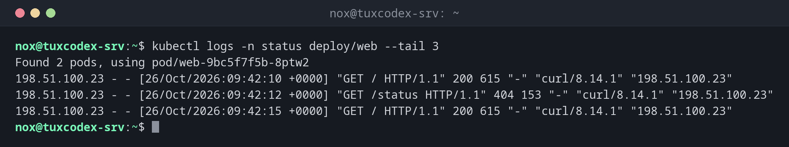

# kubectl logs

> Shows the output of the containers in a pod.



## Syntax

```bash
kubectl logs [OPTIONS] POD | TYPE/NAME [-c CONTAINER]
```

## Options

| Option | Description |
|--------|-------------|
| `POD`, `deploy/NAME` | A pod, or a pod of this deployment |
| `-l LABEL=VALUE` | All pods with this label |
| `-f`, `--follow` | Keep showing new lines |
| `--tail N` | Only the last N lines |
| `--since 1h` | Only lines of the last hour (or `10m`, `30s`) |
| `-p`, `--previous` | Output of the previous, crashed container |
| `-c CONTAINER` | Container in a pod with several containers |
| `--prefix` | Put the pod and container name in front of every line |

## Examples

**The last lines of a deployment:**

```bash
kubectl logs -n status deploy/web --tail 3
```

```text
Found 2 pods, using pod/web-9bc5f7f5b-8ptw2
198.51.100.23 - - [26/Oct/2026:09:42:10 +0000] "GET / HTTP/1.1" 200 615 "-" "curl/8.14.1" "198.51.100.23"
198.51.100.23 - - [26/Oct/2026:09:42:12 +0000] "GET /status HTTP/1.1" 404 153 "-" "curl/8.14.1" "198.51.100.23"
198.51.100.23 - - [26/Oct/2026:09:42:15 +0000] "GET / HTTP/1.1" 200 615 "-" "curl/8.14.1" "198.51.100.23"
```

**All pods of an application at once:**

```bash
kubectl logs -n status -l app=web --prefix --tail 1
```

```text
[pod/web-9bc5f7f5b-8ptw2/nginx] 198.51.100.23 - - [26/Oct/2026:09:42:15 +0000] "GET / HTTP/1.1" 200 615 "-" "curl/8.14.1" "198.51.100.23"
[pod/web-9bc5f7f5b-m8l96/nginx] 198.51.100.23 - - [26/Oct/2026:09:42:13 +0000] "GET /favicon.ico HTTP/1.1" 404 153 "-" "curl/8.14.1" "198.51.100.23"
```

**Find out why the container crashed:**

```bash
kubectl logs -n status web-7d4c9b8f6-xk2lp --previous
```

```text
2026/10/26 09:40:02 [emerg] 1#1: unknown directive "sever_name" in /etc/nginx/conf.d/default.conf:3
nginx: [emerg] unknown directive "sever_name" in /etc/nginx/conf.d/default.conf:3
```

**Follow live:**

```bash
kubectl logs -n status -f deploy/web --tail 0
```

```text
Found 2 pods, using pod/web-9bc5f7f5b-8ptw2
198.51.100.23 - - [26/Oct/2026:09:42:31 +0000] "GET / HTTP/1.1" 200 615 "-" "curl/8.14.1" "198.51.100.23"
^C
```

## When do I need it?

- When a pod is in `CrashLoopBackOff` and you need to know why
- To follow the requests of an application while testing
- To check the output of a job or a migration

!!! tip "Logs of a crashed container"
    After a crash, `kubectl logs` shows the output of the new container, which is often
    still empty. The reason for the crash is in `kubectl logs --previous POD`.

!!! warning "Logs disappear with the pod"
    When a pod is deleted or replaced, its logs are gone too. For anything you need to
    keep, collect the logs centrally, for example with Loki or the ELK stack.

## Related commands

[kubectl get](kubectl-get.md) · [kubectl describe](kubectl-describe.md) · [kubectl events](kubectl-events.md) · [kubectl exec](kubectl-exec.md)
