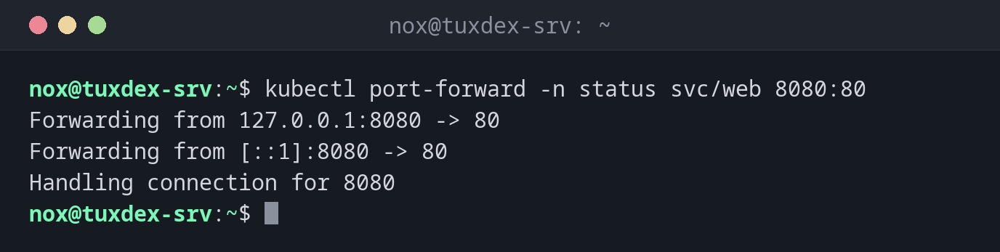

# kubectl port-forward

> Forwards a local port to a pod or service in the cluster, without making it public.



## Syntax

```bash
kubectl port-forward TYPE/NAME [LOCAL:]REMOTE [-n NAMESPACE]
```

## Options

| Option | Description |
|--------|-------------|
| `svc/NAME`, `deploy/NAME`, `POD` | Target in the cluster |
| `8080:80` | Local port 8080 to port 80 of the target |
| `:80` | Pick a free local port automatically |
| `--address 0.0.0.0` | Also accept connections from other machines (default: only localhost) |
| `-n NAMESPACE` | Namespace |

## Examples

**Make a service reachable locally:**

```bash
kubectl port-forward -n status svc/web 8080:80
```

```text
Forwarding from 127.0.0.1:8080 -> 80
Forwarding from [::1]:8080 -> 80
Handling connection for 8080
```

The forwarding runs until you end it with ++ctrl+c++. Meanwhile, `curl http://localhost:8080` reaches nginx in the cluster.

**Test from a second terminal:**

```bash
curl -s http://localhost:8080 | grep title
```

```text
<title>Welcome to nginx!</title>
```

**A local port picked automatically:**

```bash
kubectl port-forward -n status deploy/web :80
```

```text
Forwarding from 127.0.0.1:38615 -> 80
Forwarding from [::1]:38615 -> 80
```

## When do I need it?

- To test an application before it gets an ingress
- To reach a database or an admin interface in the cluster without exposing it
- To compare one pod directly with others while searching for an error

!!! tip "Through an SSH tunnel"
    From your own computer: `ssh -L 8080:localhost:8080 nox@tuxdex-srv`, and run
    `kubectl port-forward` on the server. Then `http://localhost:8080` works locally.

## Related commands

[kubectl exec](kubectl-exec.md) · [kubectl get](kubectl-get.md) · [ssh](../12-ssh/ssh.md) · [curl](../11-network/curl.md)
