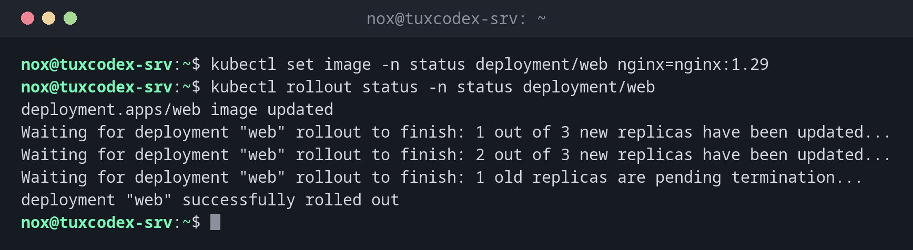

# kubectl rollout

> Watches, restarts and undoes updates of a deployment.



## Syntax

```bash
kubectl rollout SUBCOMMAND TYPE/NAME [-n NAMESPACE]
```

## Options

| Option | Description |
|--------|-------------|
| `status` | Wait until the update is finished and report the result |
| `history` | List the previous versions (revisions) |
| `undo` | Go back to the previous version; `--to-revision=N` to a specific one |
| `restart` | Replace all pods one after the other, for example to load a new ConfigMap |
| `pause`, `resume` | Pause and continue an update |

A new image version is set with `kubectl set image deployment/web nginx=nginx:1.29` or by changing the manifest.

## Examples

**Roll out a new image and wait for it:**

```bash
kubectl set image -n status deployment/web nginx=nginx:1.29
kubectl rollout status -n status deployment/web
```

```text
deployment.apps/web image updated
Waiting for deployment "web" rollout to finish: 1 out of 3 new replicas have been updated...
Waiting for deployment "web" rollout to finish: 2 out of 3 new replicas have been updated...
Waiting for deployment "web" rollout to finish: 1 old replicas are pending termination...
deployment "web" successfully rolled out
```

**The previous versions:**

```bash
kubectl rollout history -n status deployment/web
```

```text
deployment.apps/web
REVISION  CHANGE-CAUSE
1         <none>
2         <none>
```

**Back to the previous version:**

```bash
kubectl rollout undo -n status deployment/web
```

```text
deployment.apps/web rolled back
```

**Restart all pods one after the other:**

```bash
kubectl rollout restart -n status deployment/web
```

```text
deployment.apps/web restarted
```

## When do I need it?

- After a change, to know when all new pods are running
- When a new version causes errors and you have to go back quickly
- To restart all pods of an application without downtime

!!! tip "Updates without downtime"
    A deployment replaces pods one at a time and only removes an old one once the new one
    is ready. Add a `readinessProbe` so that Kubernetes knows when your application is
    really ready.

!!! warning "undo and your manifest"
    `kubectl rollout undo` changes the cluster, not your YAML file. Correct the file too,
    otherwise the next `kubectl apply` brings back the faulty version.

## Related commands

[kubectl apply](kubectl-apply.md) · [kubectl scale](kubectl-scale.md) · [kubectl get](kubectl-get.md) · [helm](helm.md)
