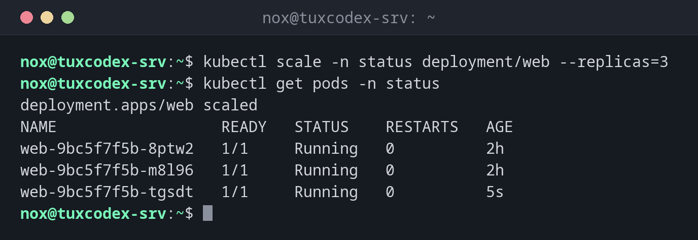

# kubectl scale

> Changes the number of pods of a deployment or StatefulSet.



## Syntax

```bash
kubectl scale TYPE/NAME --replicas=N [-n NAMESPACE]
```

## Options

| Option | Description |
|--------|-------------|
| `deployment/NAME` | The deployment (also `statefulset/NAME`) |
| `--replicas=N` | Desired number of pods; `0` stops the application without deleting it |
| `--current-replicas=N` | Only scale if there are exactly N pods right now |
| `-n NAMESPACE` | Namespace |

`kubectl autoscale deployment web --min=2 --max=5 --cpu-percent=70` adapts the number automatically to the load.

## Examples

**Three instead of two pods:**

```bash
kubectl scale -n status deployment/web --replicas=3
kubectl get pods -n status
```

```text
deployment.apps/web scaled
NAME                  READY   STATUS    RESTARTS   AGE
web-9bc5f7f5b-8ptw2   1/1     Running   0          2h
web-9bc5f7f5b-m8l96   1/1     Running   0          2h
web-9bc5f7f5b-tgsdt   1/1     Running   0          5s
```

**Stop the application during maintenance:**

```bash
kubectl scale -n status deployment/web --replicas=0
kubectl get deploy -n status
```

```text
deployment.apps/web scaled
NAME   READY   UP-TO-DATE   AVAILABLE   AGE
web    0/0     0            0           2h
```

**Scale automatically with the load:**

```bash
kubectl autoscale -n status deployment web --min=2 --max=5 --cpu-percent=70
kubectl get hpa -n status
```

```text
horizontalpodautoscaler.autoscaling/web autoscaled
NAME   REFERENCE        TARGETS              MINPODS   MAXPODS   REPLICAS   AGE
web    Deployment/web   cpu: 6%/70%          2         5         2          15s
```

## When do I need it?

- To handle more load in the short term
- To stop an application temporarily with `--replicas=0`, for example during maintenance
- To test how an application behaves with several copies

!!! warning "apply resets the number"
    The next `kubectl apply` sets the number back to `replicas:` in the manifest. For a
    lasting change, edit the file.

## Related commands

[kubectl rollout](kubectl-rollout.md) · [kubectl top](kubectl-top.md) · [kubectl apply](kubectl-apply.md) · [kubectl get](kubectl-get.md)
