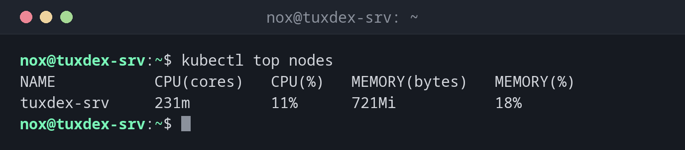

# kubectl top

> Shows the current CPU and memory usage of nodes and pods.



## Syntax

```bash
kubectl top nodes | pods [NAME] [OPTIONS]
```

## Options

| Option | Description |
|--------|-------------|
| `nodes` | Usage of the nodes |
| `pods` | Usage of the pods |
| `-n NAMESPACE`, `-A` | Pods of one namespace, or of all |
| `--containers` | Show each container of a pod separately |
| `--sort-by=cpu`, `--sort-by=memory` | Sort by usage |

CPU is given in millicores: `250m` is a quarter of a CPU core.

## Examples

**Usage of the nodes:**

```bash
kubectl top nodes
```

```text
NAME           CPU(cores)   CPU(%)   MEMORY(bytes)   MEMORY(%)
tuxdex-srv     231m         11%      721Mi           18%
```

**The pods with the most memory first:**

```bash
kubectl top pods -A --sort-by=memory
```

```text
NAMESPACE     NAME                                      CPU(cores)   MEMORY(bytes)
kube-system   traefik-6f986b958c-v9bwd                  2m           41Mi
kube-system   metrics-server-7b9c9c4b9c-m8shl           9m           22Mi
kube-system   coredns-7896679cc-2dcm2                   3m           17Mi
status        web-9bc5f7f5b-8ptw2                       3m           12Mi
status        web-9bc5f7f5b-m8l96                       3m           12Mi
kube-system   local-path-provisioner-578895bd58-x8h47   1m           8Mi
```

**One namespace:**

```bash
kubectl top pods -n status
```

```text
NAME                  CPU(cores)   MEMORY(bytes)
web-9bc5f7f5b-8ptw2   3m           12Mi
web-9bc5f7f5b-m8l96   3m           12Mi
```

## When do I need it?

- When the cluster is slow and you're looking for the pod that eats the resources
- To set sensible values for `requests` and `limits`
- To see how full a node is before you add more pods

!!! tip "Needs the metrics server"
    `kubectl top` gets its numbers from the metrics server. k3s installs it; in other
    clusters without it, you get `error: Metrics API not available`.

## Related commands

[kubectl describe](kubectl-describe.md) · [kubectl get](kubectl-get.md) · [kubectl scale](kubectl-scale.md) · [top](../08-processes/top.md)
