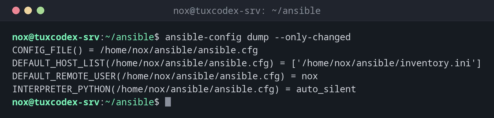

# ansible-config

> Zeigt, welche Ansible-Einstellungen gelten und woher sie stammen, und erzeugt eine Vorlage für die ansible.cfg.



## Syntax

```bash
ansible-config view | dump [--only-changed] | list | init [--disabled]
```

## Optionen

| Option | Beschreibung |
|--------|--------------|
| `view` | Die aktive Konfigurationsdatei zeigen |
| `dump` | Jede Einstellung mit ihrem aktuellen Wert zeigen |
| `dump --only-changed` | Nur Einstellungen, die vom Standard abweichen, mit ihrer Quelle |
| `list` | Alle Einstellungen mit Beschreibung, Standardwert und Umgebungsvariable |
| `init --disabled` | Eine vollständige `ansible.cfg` ausgeben, alle Einstellungen auskommentiert |
| `-c DATEI` | Diese Konfigurationsdatei verwenden |

Ansible nimmt die erste Datei, die es findet: `$ANSIBLE_CONFIG`, dann `ansible.cfg` im aktuellen Verzeichnis, dann `~/.ansible.cfg`, dann `/etc/ansible/ansible.cfg`.

## Beispiele

**Die Einstellungen zeigen, die vom Standard abweichen:**

```bash
ansible-config dump --only-changed
```

```text
CONFIG_FILE() = /home/nox/ansible/ansible.cfg
DEFAULT_HOST_LIST(/home/nox/ansible/ansible.cfg) = ['/home/nox/ansible/inventory.ini']
DEFAULT_REMOTE_USER(/home/nox/ansible/ansible.cfg) = nox
INTERPRETER_PYTHON(/home/nox/ansible/ansible.cfg) = auto_silent
```

In Klammern steht die Quelle jedes Werts: hier die `ansible.cfg` des Projekts.

**Die aktive Konfigurationsdatei:**

```bash
ansible-config view
```

```text
[defaults]
inventory = inventory.ini
remote_user = nox
interpreter_python = auto_silent
```

**Version und Konfigurationsdatei:**

```bash
ansible --version | head -3
```

```text
ansible [core 2.19.11]
  config file = /home/nox/ansible/ansible.cfg
  configured module search path = ['/home/nox/.ansible/plugins/modules', '/usr/share/ansible/plugins/modules']
```

**Eine Vorlage mit allen Einstellungen:**

```bash
ansible-config init --disabled > ansible.cfg.example
grep -A2 '^# (integer) Maximum number of forks' ansible.cfg.example
```

```text
# (integer) Maximum number of forks Ansible will use to execute tasks on target hosts.
;forks=5

```

## Wann brauche ich das?

- Um herauszufinden, warum sich Ansible in einem Verzeichnis anders verhält als in einem anderen
- Um ein neues Projekt mit einer dokumentierten `ansible.cfg` zu beginnen
- Um den Namen einer Einstellung oder ihre Umgebungsvariable zu finden

!!! tip "ansible --version zeigt die Datei"
    Die zweite Zeile von `ansible --version` zeigt, welche Konfigurationsdatei aktiv ist,
    oder `config file = None`, wenn es keine gibt.

!!! warning "ansible.cfg in einem für alle beschreibbaren Verzeichnis"
    Ansible ignoriert eine `ansible.cfg` in einem Verzeichnis, in das jeder schreiben darf,
    etwa `/tmp`, und gibt eine Warnung aus. Leg Projekte in deinem Home-Verzeichnis ab.

## Verwandte Befehle

[ansible-inventory](ansible-inventory.md) · [ansible](ansible.md) · [ansible-playbook](ansible-playbook.md)
