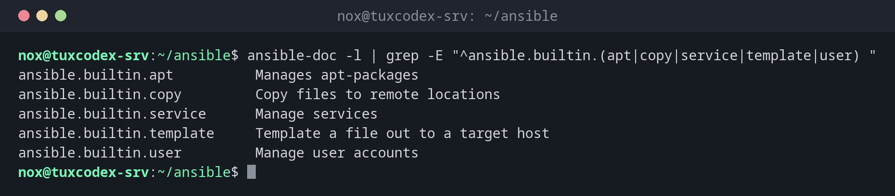

# ansible-doc

> Zeigt die Dokumentation von Modulen und Plugins im Terminal, mit allen Parametern und Beispielen.



## Syntax

```bash
ansible-doc [-l | -s] [MODUL]
```

## Optionen

| Option | Beschreibung |
|--------|--------------|
| `MODUL` | Vollständige Dokumentation eines Moduls, etwa `ansible.builtin.copy` |
| `-l`, `--list` | Alle installierten Module mit Kurzbeschreibung auflisten |
| `-s`, `--snippet` | Nur eine kurze Vorlage für einen Task |
| `-t TYP` | Andere Plugin-Typen, etwa `lookup`, `filter` oder `callback` |
| `-F` | Die Module mit dem Pfad zu ihrer Datei auflisten |

## Beispiele

**Module finden:**

```bash
ansible-doc -l | grep -E "^ansible.builtin.(apt|copy|service|template|user) "
```

```text
ansible.builtin.apt          Manages apt-packages
ansible.builtin.copy         Copy files to remote locations
ansible.builtin.service      Manage services
ansible.builtin.template     Template a file out to a target host
ansible.builtin.user         Manage user accounts
```

**Eine Vorlage für einen Task:**

```bash
ansible-doc -s ansible.builtin.service | head -12
```

```text
- name: Manage services
  service:
      arguments:             # Additional arguments provided on the command line.
                             # While using remote hosts with systemd this
                             # setting will be ignored.
      enabled:               # Whether the service should start on boot. At
                             # least one of `state' and `enabled' are required.
      name:                  # (required) Name of the service.
      pattern:               # If the service does not respond to the status
                             # command, name a substring to look for as would
                             # be found in the output of the `ps' command as a
                             # stand-in for a status result.
```

**Die vollständige Dokumentation eines Moduls:**

```bash
ansible-doc ansible.builtin.copy | head -9
```

```text
> MODULE ansible.builtin.copy (/usr/lib/python3/dist-packages/ansible/modules/copy.py)

  The ansible.builtin.copy module copies a file or a directory
  structure from the local or remote machine to a location on the
  remote machine. File system meta-information (permissions,
  ownership, etc.) may be set, even when the file or directory already
  exists on the target system. Some meta-information may be copied on
  request.
  Get meta-information with the ansible.builtin.stat module.
```

## Wann brauche ich das?

- Um herauszufinden, welche Parameter ein Modul kennt, ganz ohne Browser
- Um das passende Modul für eine Aufgabe zu finden
- Um die Dokumentation genau der Version zu lesen, die auf dem Steuerrechner installiert ist

!!! tip "Zu den Beispielen springen"
    Die Dokumentation jedes Moduls endet mit dem Abschnitt `EXAMPLES`. Im Pager tippst du
    `/EXAMPLES` und ++enter++, um dorthin zu springen.

## Verwandte Befehle

[ansible](ansible.md) · [ansible-galaxy](ansible-galaxy.md) · [ansible-playbook](ansible-playbook.md)
