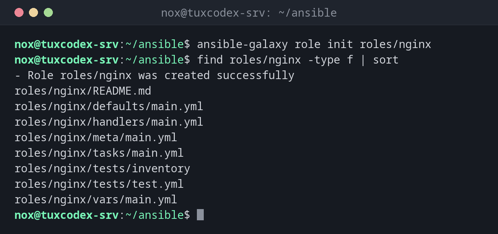

# ansible-galaxy

> Legt Rollen an und installiert Rollen und Collections aus Ansible Galaxy oder einem Git-Repository.



## Syntax

```bash
ansible-galaxy role init | install | list ...
ansible-galaxy collection install | list ...
```

## Optionen

| Option | Beschreibung |
|--------|--------------|
| `role init NAME` | Die Verzeichnisstruktur für eine neue Rolle anlegen |
| `role install NAME` | Eine Rolle installieren, etwa `geerlingguy.ntp` |
| `collection install NAME` | Eine Collection installieren, etwa `community.general` |
| `-r requirements.yml` | Alles installieren, was in einer Datei steht |
| `list` | Die installierten Rollen oder Collections zeigen |
| `-p VERZEICHNIS` | In dieses Verzeichnis statt nach `~/.ansible` installieren |
| `--force` | Erneut installieren, auch zum Aktualisieren |

## Beispiele

**Eine neue Rolle anlegen:**

```bash
ansible-galaxy role init roles/nginx
find roles/nginx -type f | sort
```

```text
- Role roles/nginx was created successfully
roles/nginx/README.md
roles/nginx/defaults/main.yml
roles/nginx/handlers/main.yml
roles/nginx/meta/main.yml
roles/nginx/tasks/main.yml
roles/nginx/tests/inventory
roles/nginx/tests/test.yml
roles/nginx/vars/main.yml
```

**Eine Rolle aus Galaxy installieren:**

```bash
ansible-galaxy role install geerlingguy.ntp
```

```text
Starting galaxy role install process
- downloading role 'ntp', owned by geerlingguy
- downloading role from https://github.com/geerlingguy/ansible-role-ntp/archive/4.0.1.tar.gz
- extracting geerlingguy.ntp to /home/nox/.ansible/roles/geerlingguy.ntp
- geerlingguy.ntp (4.0.1) was installed successfully
```

**Die installierte Version einer Collection zeigen:**

```bash
ansible-galaxy collection list community.general
```

```text
# /usr/lib/python3/dist-packages/ansible_collections
Collection        Version
----------------- -------
community.general 11.2.1
```

Unter Debian bringt das Paket `ansible` die Collections in `/usr/lib/python3/dist-packages/ansible_collections` mit.

**Alles installieren, was ein Projekt braucht:**

```bash
cat requirements.yml
ansible-galaxy install -r requirements.yml
```

```text
roles:
  - name: geerlingguy.ntp
    version: 4.0.1
collections:
  - name: community.general
    version: ">=11.0.0"
Starting galaxy role install process
- geerlingguy.ntp (4.0.1) is already installed, skipping.
Starting galaxy collection install process
Nothing to do. All requested collections are already installed. If you want to reinstall them, consider using `--force`.
```

## Wann brauche ich das?

- Um eigene Tasks in wiederverwendbare Rollen aufzuteilen
- Um fertige Rollen für verbreitete Software zu nutzen, statt alles selbst zu schreiben
- Um auf einem neuen Steuerrechner die Collections zu installieren, die ein Projekt braucht

!!! tip "requirements.yml für jedes Projekt"
    Schreib die Rollen und Collections eines Projekts mit festen Versionen in eine
    `requirements.yml`. Dann richtet `ansible-galaxy install -r requirements.yml` jeden
    Steuerrechner gleich ein.

!!! warning "Fremde Rollen laufen als root"
    Eine Rolle aus Galaxy läuft mit `become` auf deinen Servern. Lies ihre Tasks, bevor du
    sie nutzt, und leg die Version fest, damit ein Update nichts unbemerkt ändert.

## Verwandte Befehle

[ansible-playbook](ansible-playbook.md) · [ansible-doc](ansible-doc.md) · [ansible-lint](ansible-lint.md)
