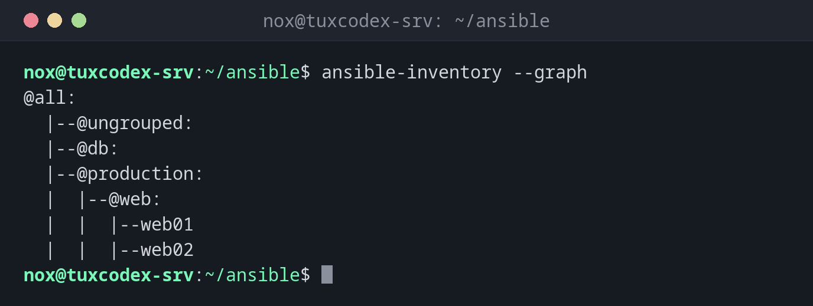

# ansible-inventory

> Zeigt das Inventar so, wie Ansible es versteht: Gruppen, Server und ihre Variablen.



## Syntax

```bash
ansible-inventory [-i INVENTAR] --graph | --list | --host HOST
```

## Optionen

| Option | Beschreibung |
|--------|--------------|
| `--graph [GRUPPE]` | Gruppen und Server als Baum |
| `--list` | Alles als JSON, mit allen Variablen |
| `--host HOST` | Die Variablen eines Servers |
| `--vars` | Mit `--graph`: auch die Variablen zeigen |
| `-i DATEI` | Dieses Inventar statt des konfigurierten nutzen |
| `-y`, `--yaml` | YAML statt JSON |

## Beispiele

**Gruppen und Server als Baum:**

```bash
ansible-inventory --graph
```

```text
@all:
  |--@ungrouped:
  |--@db:
  |--@production:
  |  |--@web:
  |  |  |--web01
  |  |  |--web02
```

**Die Variablen eines Servers:**

```bash
ansible-inventory --host web01
```

```text
{
    "ansible_host": "192.0.2.21",
    "nginx_worker_connections": 1024
}
```

`nginx_worker_connections` kommt aus `group_vars/web.yml`, weil `web01` in der Gruppe `web` ist.

**Das ganze Inventar als JSON:**

```bash
ansible-inventory --list | head -20
```

```text
{
    "_meta": {
        "hostvars": {
            "web01": {
                "ansible_host": "192.0.2.21",
                "nginx_worker_connections": 1024
            },
            "web02": {
                "ansible_host": "192.0.2.22",
                "nginx_worker_connections": 1024
            }
        },
        "profile": "inventory_legacy"
    },
    "all": {
        "children": [
            "ungrouped",
            "db",
            "production"
        ]
```

## Wann brauche ich das?

- Um zu prüfen, dass neue Server in den richtigen Gruppen gelandet sind
- Um herauszufinden, welchen Wert eine Variable auf einem Server hat und aus welcher Datei
- Um ein dynamisches Inventar zu testen, etwa von einem Cloud-Anbieter

!!! tip "Muster für Ziele"
    `web:db` heißt beide Gruppen, `web:!web02` die Gruppe ohne einen Server, `web:&production`
    nur Server in beiden Gruppen. Dieselben Muster funktionieren bei `ansible` und `--limit`.

## Verwandte Befehle

[ansible](ansible.md) · [ansible-playbook](ansible-playbook.md) · [ansible-config](ansible-config.md)
