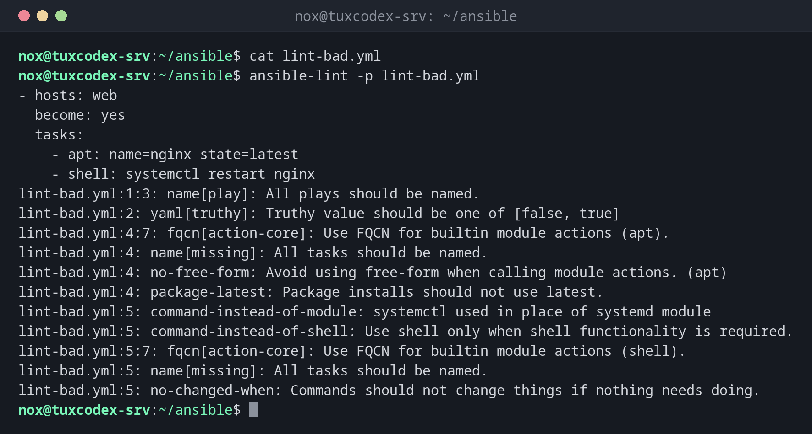

# ansible-lint

> Prüft Playbooks und Rollen auf Fehler, schlechte Praktiken und Stilprobleme, bevor sie laufen.



## Syntax

```bash
ansible-lint [OPTIONEN] [DATEI|VERZEICHNIS...]
```

## Optionen

| Option | Beschreibung |
|--------|--------------|
| (keine) | Das ganze Projekt im aktuellen Verzeichnis prüfen |
| `DATEI` | Nur diese Playbooks oder Rollen prüfen |
| `--fix` | Beheben, was sich automatisch beheben lässt, etwa FQCN und YAML-Formatierung |
| `--profile NAME` | Strenge: `min`, `basic`, `moderate`, `safety`, `shared`, `production` |
| `-x REGEL` | Eine Regel überspringen |
| `-L` | Alle Regeln auflisten |
| `-p` | Kompakte Ausgabe, eine Zeile pro Problem |

## Beispiele

**Ein Playbook mit Problemen prüfen:**

```bash
cat lint-bad.yml
ansible-lint -p lint-bad.yml
```

```text
- hosts: web
  become: yes
  tasks:
    - apt: name=nginx state=latest
    - shell: systemctl restart nginx
lint-bad.yml:1:3: name[play]: All plays should be named.
lint-bad.yml:2: yaml[truthy]: Truthy value should be one of [false, true]
lint-bad.yml:4:7: fqcn[action-core]: Use FQCN for builtin module actions (apt).
lint-bad.yml:4: name[missing]: All tasks should be named.
lint-bad.yml:4: no-free-form: Avoid using free-form when calling module actions. (apt)
lint-bad.yml:4: package-latest: Package installs should not use latest.
lint-bad.yml:5: command-instead-of-module: systemctl used in place of systemd module
lint-bad.yml:5: command-instead-of-shell: Use shell only when shell functionality is required.
lint-bad.yml:5:7: fqcn[action-core]: Use FQCN for builtin module actions (shell).
lint-bad.yml:5: name[missing]: All tasks should be named.
lint-bad.yml:5: no-changed-when: Commands should not change things if nothing needs doing.
```

**Die ausführliche Ausgabe mit Zusammenfassung:**

```bash
ansible-lint lint-bad.yml | tail -15
```

```text
# Rule Violation Summary

  1 command-instead-of-module profile:basic tags:command-shell,idiom
  1 command-instead-of-shell profile:basic tags:command-shell,idiom
  1 no-free-form profile:basic tags:syntax,risk
  2 name profile:basic tags:idiom
  1 name profile:basic tags:idiom
  1 yaml profile:basic tags:formatting,yaml
  1 package-latest profile:basic tags:idempotency
  1 no-changed-when profile:basic tags:command-shell,idempotency
  2 fqcn profile:basic tags:formatting

Failed: 11 failure(s), 0 warning(s) on 1 files. Last profile that met the validation criteria was 'min'.
```

**Ein sauberes Playbook:**

```bash
ansible-lint site.yml
```

```text
Passed: 0 failure(s), 0 warning(s) on 1 files. Last profile that met the validation criteria was 'production'.
```

`site.yml` aus den [Grundlagen](basics.md) erfüllt sogar `production`, das strengste Profil.

## Wann brauche ich das?

- Vor jedem Commit eines Ansible-Projekts
- In einer CI-Pipeline, damit fehlerhafte Playbooks nie auf die Server kommen
- Um gute Gewohnheiten zu lernen: Jede Regel erklärt, was falsch ist und warum

!!! tip "Konfiguration pro Projekt"
    Eine Datei `.ansible-lint` im Projekt legt Profil und übersprungene Regeln fest, etwa
    `profile: production` und `skip_list: [yaml[line-length]]`.

!!! warning "Den Grund beheben, nicht die Meldung"
    `# noqa` am Zeilenende blendet einen Fund aus. Nutze es nur mit gutem Grund und schreib
    den Grund daneben.

## Unterschiede zwischen Distributionen

| | Debian | Ubuntu | RHEL | Arch |
|---|--------|--------|------|------|
| Installation | `sudo apt install ansible-lint` | `sudo apt install ansible-lint` | `pipx install ansible-lint` | `sudo pacman -S ansible-lint` |

## Verwandte Befehle

[ansible-playbook](ansible-playbook.md) · [ansible-galaxy](ansible-galaxy.md) · [shellcheck](../17-bash-scripting/shellcheck.md)
