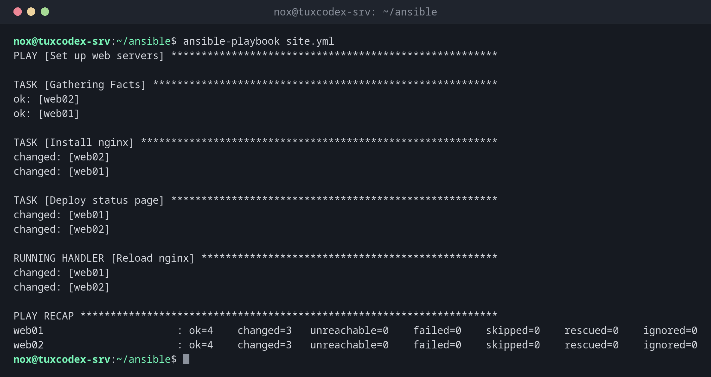

# ansible-playbook

> Führt ein Playbook aus: alle seine Tasks der Reihe nach, auf den Servern, die es nennt.



## Syntax

```bash
ansible-playbook [OPTIONEN] PLAYBOOK.yml
```

## Optionen

| Option | Beschreibung |
|--------|--------------|
| `--check` | Probelauf: zeigen, was sich ändern würde, nichts ändern |
| `--diff` | Die Änderungen in Dateien Zeile für Zeile zeigen |
| `-l`, `--limit MUSTER` | Nur diese Server, etwa `web01` |
| `-t`, `--tags TAGS` | Nur Tasks mit diesen Tags |
| `--skip-tags TAGS` | Tasks mit diesen Tags überspringen |
| `--syntax-check` | Nur die Syntax prüfen |
| `--list-tasks`, `--list-hosts` | Zeigen, welche Tasks auf welchen Servern laufen würden |
| `-e VAR=WERT` | Eine zusätzliche Variable setzen |
| `--ask-vault-pass`, `--vault-password-file DATEI` | Passwort für verschlüsselte Dateien |
| `-v`, `-vvv` | Mehr Ausgabe, für die Fehlersuche |

## Beispiele

**Die Webserver einrichten:**

```bash
ansible-playbook site.yml
```

```text
PLAY [Set up web servers] ******************************************************

TASK [Gathering Facts] *********************************************************
ok: [web02]
ok: [web01]

TASK [Install nginx] ***********************************************************
changed: [web02]
changed: [web01]

TASK [Deploy status page] ******************************************************
changed: [web01]
changed: [web02]

RUNNING HANDLER [Reload nginx] *************************************************
changed: [web01]
changed: [web02]

PLAY RECAP *********************************************************************
web01                      : ok=4    changed=3   unreachable=0    failed=0    skipped=0    rescued=0    ignored=0
web02                      : ok=4    changed=3   unreachable=0    failed=0    skipped=0    rescued=0    ignored=0
```

Das Playbook steht in den [Grundlagen](basics.md). `changed=3`: nginx installiert, Seite geschrieben, nginx neu geladen.

**Der zweite Lauf ändert nichts:**

```bash
ansible-playbook site.yml
```

```text
PLAY [Set up web servers] ******************************************************

TASK [Gathering Facts] *********************************************************
ok: [web01]
ok: [web02]

TASK [Install nginx] ***********************************************************
ok: [web02]
ok: [web01]

TASK [Deploy status page] ******************************************************
ok: [web02]
ok: [web01]

PLAY RECAP *********************************************************************
web01                      : ok=3    changed=0   unreachable=0    failed=0    skipped=0    rescued=0    ignored=0
web02                      : ok=3    changed=0   unreachable=0    failed=0    skipped=0    rescued=0    ignored=0
```

Alles ist `ok`, deshalb läuft auch der Handler nicht.

**Eine Änderung vorher ansehen:**

```bash
ansible-playbook site.yml --check --diff --limit web01
```

```text
PLAY [Set up web servers] ******************************************************

TASK [Gathering Facts] *********************************************************
ok: [web01]

TASK [Install nginx] ***********************************************************
ok: [web01]

TASK [Deploy status page] ******************************************************
--- before: /var/www/html/index.html
+++ after: /var/www/html/index.html
@@ -1 +1 @@
-<h1>web01: all systems operational</h1>
+<h1>web01: maintenance tonight 22:00</h1>

changed: [web01]

RUNNING HANDLER [Reload nginx] *************************************************
changed: [web01]

PLAY RECAP *********************************************************************
web01                      : ok=4    changed=2   unreachable=0    failed=0    skipped=0    rescued=0    ignored=0
```

**Nur einige Tasks auf einem Server:**

```bash
ansible-playbook site.yml --limit web01 --tags packages
```

```text
PLAY [Set up web servers] ******************************************************

TASK [Gathering Facts] *********************************************************
ok: [web01]

TASK [Install nginx] ***********************************************************
ok: [web01]

PLAY RECAP *********************************************************************
web01                      : ok=2    changed=0   unreachable=0    failed=0    skipped=0    rescued=0    ignored=0
```

**Die Tasks des Playbooks auflisten:**

```bash
ansible-playbook site.yml --list-tasks
```

```text
playbook: site.yml

  play #1 (web): Set up web servers     TAGS: []
    tasks:
      Install nginx     TAGS: [packages]
      Deploy status page        TAGS: []
```

## Wann brauche ich das?

- Um neue Server genauso einzurichten wie die bestehenden
- Um eine Konfigurationsänderung auf allen Servern gleichzeitig auszurollen
- Regelmäßig, um Server zurückzusetzen, die jemand von Hand geändert hat

!!! tip "Erst --check --diff, dann echt"
    `ansible-playbook site.yml --check --diff` zeigt jede Änderung, bevor sie passiert. Auf
    Produktionsservern sollte das der erste Schritt jedes Laufs sein.

!!! warning "--check hat Grenzen"
    Im Check-Modus wird nichts installiert. Ein späterer Task, der darauf aufbaut, etwa nginx
    auf einem frischen Server neu laden, kann im Check-Modus scheitern, obwohl der echte Lauf
    funktioniert.

## Verwandte Befehle

[ansible](ansible.md) · [ansible-vault](ansible-vault.md) · [ansible-lint](ansible-lint.md) · [ansible-inventory](ansible-inventory.md)
