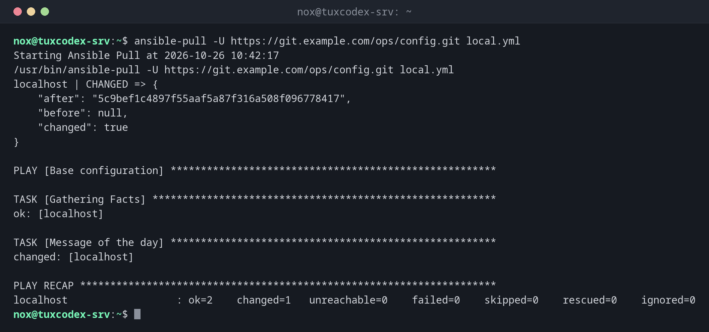

# ansible-pull

> Turns the direction around: the server fetches a playbook from a Git repository and applies it to itself.



## Syntax

```bash
ansible-pull -U REPO_URL [OPTIONS] [PLAYBOOK.yml]
```

## Options

| Option | Description |
|--------|-------------|
| `-U URL` | Git repository with the playbooks |
| `PLAYBOOK.yml` | Playbook to run; without it, `<hostname>.yml` or `local.yml` |
| `-C BRANCH` | Branch or tag to check out |
| `-d DIRECTORY` | Where to check out the repository (default `~/.ansible/pull/<hostname>`) |
| `-o`, `--only-if-changed` | Only run if the repository has new commits |
| `-s SECONDS` | Wait a random time up to this many seconds first, so not all servers start at once |
| `--vault-password-file FILE` | Password for encrypted files |

## Examples

**Fetch and apply the configuration:**

```bash
ansible-pull -U https://git.example.com/ops/config.git local.yml
```

```text
Starting Ansible Pull at 2026-10-26 10:42:17
/usr/bin/ansible-pull -U https://git.example.com/ops/config.git local.yml
localhost | CHANGED => {
    "after": "5c9bef1c4897f55aaf5a87f316a508f096778417",
    "before": null,
    "changed": true
}

PLAY [Base configuration] ******************************************************

TASK [Gathering Facts] *********************************************************
ok: [localhost]

TASK [Message of the day] ******************************************************
changed: [localhost]

PLAY RECAP *********************************************************************
localhost                  : ok=2    changed=1   unreachable=0    failed=0    skipped=0    rescued=0    ignored=0
```

The first block is the `git` checkout, then the playbook runs as usual. Depending on the playbook, Ansible also prints warnings about the host pattern; they are harmless.

**Only run when something changed:**

```bash
ansible-pull -U https://git.example.com/ops/config.git -o local.yml
```

```text
Starting Ansible Pull at 2026-10-26 11:12:17
/usr/bin/ansible-pull -U https://git.example.com/ops/config.git -o local.yml
localhost | SUCCESS => {
    "after": "5c9bef1c4897f55aaf5a87f316a508f096778417",
    "before": "5c9bef1c4897f55aaf5a87f316a508f096778417",
    "changed": false,
    "remote_url_changed": false
}
Repository has not changed, quitting: ...
```

**The playbook in the repository:**

```bash
cat ~/.ansible/pull/tuxcodex-srv/local.yml
```

```text
- name: Base configuration
  hosts: localhost
  connection: local
  tasks:
    - name: Message of the day
      ansible.builtin.copy:
        content: "Managed by Ansible. Changes will be overwritten.\n"
        dest: ~/motd.txt
        mode: "0644"
```

## When do I need it?

- For many servers that should configure themselves, for example from a cron job
- For servers that the control node can't reach, such as machines behind NAT
- To set up a new server at the end of its installation with a single command

!!! tip "As a cron job or timer"
    `*/30 * * * * ansible-pull -U https://git.example.com/ops/config.git -o -s 300` checks
    every 30 minutes, only applies changes, and spreads the load. See [`crontab`](../16-scheduling/crontab.md).

!!! warning "The repository has power over the server"
    Whoever can push to the repository can run any command on every server that pulls
    from it. Protect the repository like root access.

## Related commands

[ansible-playbook](ansible-playbook.md) · [ansible-vault](ansible-vault.md) · [git clone](../18-git/git-clone.md) · [crontab](../16-scheduling/crontab.md)
