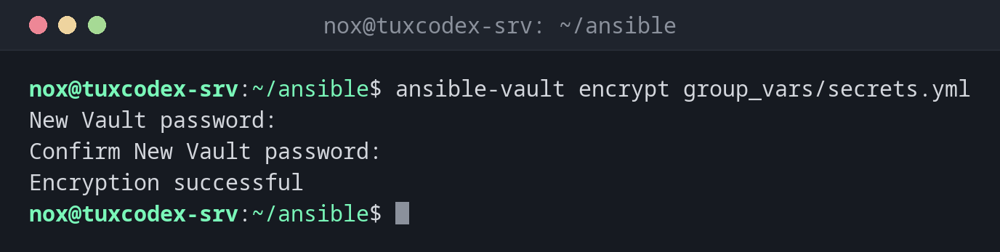

# ansible-vault

> Encrypts files and values with passwords, so that secrets can go into the Git repository of the project.



## Syntax

```bash
ansible-vault create | encrypt | decrypt | view | edit | rekey FILE
ansible-vault encrypt_string VALUE --name VARIABLE
```

## Options

| Option | Description |
|--------|-------------|
| `create FILE` | Create a new encrypted file in the editor |
| `encrypt FILE` | Encrypt an existing file |
| `view FILE` | Show the content without saving it decrypted |
| `edit FILE` | Edit in the editor, then encrypt again |
| `decrypt FILE` | Decrypt permanently |
| `rekey FILE` | Change the vault password |
| `encrypt_string` | Encrypt a single value for use in a normal YAML file |
| `--vault-password-file FILE` | Read the password from a file instead of asking |

## Examples

**Encrypt a file with passwords:**

```bash
ansible-vault encrypt group_vars/secrets.yml
```

```text
New Vault password:
Confirm New Vault password:
Encryption successful
```

**What the file looks like now:**

```bash
head -3 group_vars/secrets.yml
```

```text
$ANSIBLE_VAULT;1.1;AES256
37626437363538343563666534313964333566323336393839383138626636376538383034656262
6463643237393466356266303034303132393431616464310a383131396365653136636362313431
```

**Read the content:**

```bash
ansible-vault view --vault-password-file ~/.vault_pass group_vars/secrets.yml
```

```text
db_password: S3cr3t-Pa55
```

**Encrypt a single value:**

```bash
ansible-vault encrypt_string --vault-password-file ~/.vault_pass 'S3cr3t-Pa55' --name db_password
```

```text
db_password: !vault |
          $ANSIBLE_VAULT;1.1;AES256
          39356637356462313933343739313665396566343538303430613339663830393138663233393730
          3361643539663062386234306235383966356231323939390a633932343230393339363466653938
          37633630653434326232636138376266653661653832363263663838663632336335386639383065
          3163316534616634360a303961373638323463643334373139303231613735666130333437643932
          6331
```

Paste the output into a normal variables file. The rest of the file stays readable.

**Run a playbook with encrypted variables:**

```bash
ansible-playbook site.yml --ask-vault-pass --limit web01 --tags packages
```

```text
Vault password:

PLAY [Set up web servers] ******************************************************

TASK [Gathering Facts] *********************************************************
ok: [web01]

TASK [Install nginx] ***********************************************************
ok: [web01]

PLAY RECAP *********************************************************************
web01                      : ok=2    changed=0   unreachable=0    failed=0    skipped=0    rescued=0    ignored=0
```

## When do I need it?

- For passwords, API keys and private keys that a playbook needs
- To keep a whole project in Git without exposing secrets
- In CI pipelines, together with a password file that only the pipeline knows

!!! tip "Password file instead of typing"
    Put the vault password in `~/.vault_pass` with mode `600` and set
    `vault_password_file = ~/.vault_pass` in `ansible.cfg`. Never commit this file.

!!! danger "Lost password, lost data"
    There is no way to decrypt a vault file without the password. Store it in your password
    manager.

## Related commands

[ansible-playbook](ansible-playbook.md) · [ansible-pull](ansible-pull.md) · [ansible-config](ansible-config.md)
