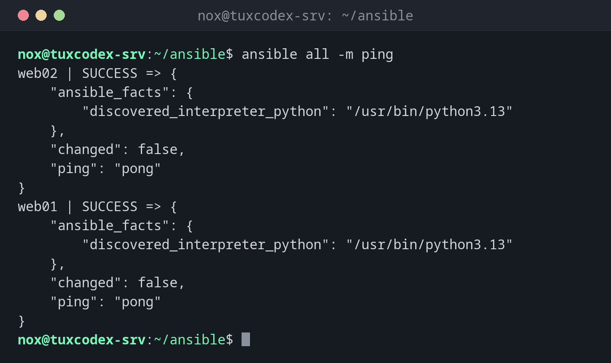

# ansible

> Runs a single module on a group of servers right away, without a playbook (ad hoc commands).



## Syntax

```bash
ansible PATTERN [-m MODULE] [-a "ARGUMENTS"] [OPTIONS]
```

## Options

| Option | Description |
|--------|-------------|
| `PATTERN` | Target: a server, a group, `all` or a pattern like `web:!web02` |
| `-m MODULE` | Module to run, by default `command` |
| `-a ARGUMENTS` | Arguments of the module, such as `"name=htop state=present"` |
| `-b`, `--become` | Run with `sudo` |
| `-K`, `--ask-become-pass` | Ask for the `sudo` password |
| `-i INVENTORY` | Another inventory |
| `-f N`, `--forks N` | How many servers at the same time (default 5) |
| `--check`, `--diff` | Only show what would change |

## Examples

**Check that all servers are reachable:**

```bash
ansible all -m ping
```

```text
web02 | SUCCESS => {
    "ansible_facts": {
        "discovered_interpreter_python": "/usr/bin/python3.13"
    },
    "changed": false,
    "ping": "pong"
}
web01 | SUCCESS => {
    "ansible_facts": {
        "discovered_interpreter_python": "/usr/bin/python3.13"
    },
    "changed": false,
    "ping": "pong"
}
```

`ping` doesn't send ICMP packets: it logs in via SSH and checks that Python works.

**A command on all web servers:**

```bash
ansible web -a "uptime"
```

```text
web01 | CHANGED | rc=0 >>
 10:42:17 up 12 days,  3:05,  1 user,  load average: 0.08, 0.03, 0.01
web02 | CHANGED | rc=0 >>
 10:42:17 up 12 days,  3:05,  0 users,  load average: 0.02, 0.04, 0.00
```

**Install a package everywhere:**

```bash
ansible web -b -m apt -a "name=htop state=present"
```

```text
web01 | SUCCESS => {
    "ansible_facts": {
        "discovered_interpreter_python": "/usr/bin/python3.13"
    },
    "cache_update_time": 1793101332,
    "cache_updated": false,
    "changed": false
}
web02 | SUCCESS => {
    "ansible_facts": {
        "discovered_interpreter_python": "/usr/bin/python3.13"
    },
    "cache_update_time": 1793101333,
    "cache_updated": false,
    "changed": false
}
```

`SUCCESS` with `"changed": false`: htop was already installed, so nothing happened. On the first run, it says `CHANGED`.

**Pipes need the shell module:**

```bash
ansible web01 -m shell -a "df -h / | tail -1"
```

```text
web01 | CHANGED | rc=0 >>
/dev/sda2        38G  6.1G   30G  17% /
```

**Facts about the distribution:**

```bash
ansible web01 -m setup -a "filter=ansible_distribution*"
```

```text
web01 | SUCCESS => {
    "ansible_facts": {
        "ansible_distribution": "Debian",
        "ansible_distribution_file_parsed": true,
        "ansible_distribution_file_path": "/etc/os-release",
        "ansible_distribution_file_variety": "Debian",
        "ansible_distribution_major_version": "13",
        "ansible_distribution_minor_version": "1",
        "ansible_distribution_release": "trixie",
        "ansible_distribution_version": "13.1",
        "discovered_interpreter_python": "/usr/bin/python3.13"
    },
    "changed": false
}
```

## When do I need it?

- To check quickly whether all servers are reachable
- To run a command on all servers, such as `uptime` or a disk check
- For one-off changes, such as installing a package on every web server

!!! tip "Facts about a server"
    `ansible web01 -m setup` shows everything Ansible knows about a server: distribution,
    IP addresses, memory, disks. Filter with `-a "filter=ansible_*mem*"`.

!!! warning "command doesn't know shell syntax"
    The default module `command` runs the program directly, without a shell: pipes (`|`),
    redirects and `*` don't work. Use `-m shell` for those.

## Distribution differences

| | Debian | Ubuntu | RHEL | Arch |
|---|--------|--------|------|------|
| Install | `sudo apt install ansible` | `sudo apt install ansible` | `sudo dnf install ansible-core` (full `ansible` from EPEL) | `sudo pacman -S ansible` |

## Related commands

[ansible-playbook](ansible-playbook.md) · [ansible-inventory](ansible-inventory.md) · [ansible-doc](ansible-doc.md) · [ssh](../12-ssh/ssh.md)
