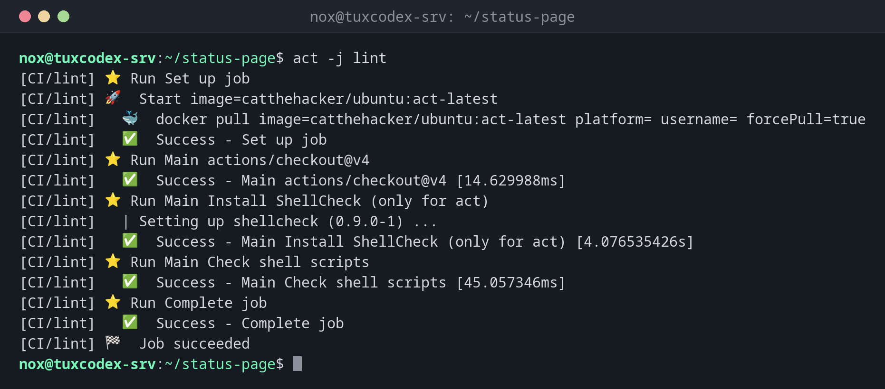

# act

> Führt GitHub-Actions-Workflows lokal in Docker-Containern aus, damit du sie vor dem Push testen kannst.



## Syntax

```bash
act [EREIGNIS] [-j JOB] [OPTIONEN]
```

## Optionen

| Option | Beschreibung |
|--------|--------------|
| `EREIGNIS` | Zu simulierendes Ereignis, etwa `push` (Standard) oder `pull_request` |
| `-l`, `--list` | Die Workflows und Jobs auflisten |
| `-j JOB` | Nur diesen Job (plus die Jobs, die er per `needs` braucht) |
| `-n`, `--dryrun` | Nur zeigen, was laufen würde |
| `-W DATEI` | Nur diese Workflow-Datei |
| `-s NAME=WERT`, `--secret-file DATEI` | Secrets für den Lauf |
| `-P LABEL=IMAGE` | Docker-Image für ein Runner-Label, etwa `ubuntu-latest` |

Beim ersten Start fragt `act`, welche Image-Größe es nutzen soll, und speichert die Antwort in `~/.config/act/actrc`.

## Beispiele

**Einen Job lokal ausführen:**

```bash
act -j lint
```

```text
[CI/lint] ⭐ Run Set up job
[CI/lint] 🚀  Start image=catthehacker/ubuntu:act-latest
[CI/lint]   🐳  docker pull image=catthehacker/ubuntu:act-latest platform= username= forcePull=true
[CI/lint]   ✅  Success - Set up job
[CI/lint] ⭐ Run Main actions/checkout@v4
[CI/lint]   ✅  Success - Main actions/checkout@v4 [14.629988ms]
[CI/lint] ⭐ Run Main Install ShellCheck (only for act)
[CI/lint]   | Setting up shellcheck (0.9.0-1) ...
[CI/lint]   ✅  Success - Main Install ShellCheck (only for act) [4.076535426s]
[CI/lint] ⭐ Run Main Check shell scripts
[CI/lint]   ✅  Success - Main Check shell scripts [45.057346ms]
[CI/lint] ⭐ Run Complete job
[CI/lint]   ✅  Success - Complete job
[CI/lint] 🏁  Job succeeded
```

Gekürzt; bei jedem Schritt gibt `act` außerdem die Docker-Befehle aus, die es ausführt.

**Die Jobs aller Workflows:**

```bash
act -l
```

```text
Stage  Job ID  Job name  Workflow name  Workflow file  Events
0      lint    lint      CI             ci.yml         pull_request,push
1      build   build     CI             ci.yml         push,pull_request
```

**Ein Werkzeug fehlt im act-Image:**

```bash
act -j lint
```

```text
[CI/lint] ⭐ Run Main Check shell scripts
[CI/lint]   🐳  docker exec cmd=[bash -e /var/run/act/workflow/1] user= workdir=
[CI/lint]   | /var/run/act/workflow/1: line 2: shellcheck: command not found
[CI/lint]   ❌  Failure - Main Check shell scripts [44.675812ms]
[CI/lint] exitcode '127': command not found, please refer to https://github.com/nektos/act/issues/107 for more information
[CI/lint] 🏁  Job failed
Error: Job 'lint' failed
```

Auf GitHub ist `shellcheck` vorinstalliert. Abhilfe schafft der Schritt mit `if: ${{ env.ACT }}` aus dem Tipp unten.

**Nur zeigen, was laufen würde:**

```bash
act -n | grep -E 'Run Main|Job succeeded'
```

```text
*DRYRUN* [CI/lint] ⭐ Run Main actions/checkout@v4
*DRYRUN* [CI/lint] ⭐ Run Main Check shell scripts
*DRYRUN* [CI/lint] 🏁  Job succeeded
*DRYRUN* [CI/build] ⭐ Run Main actions/checkout@v4
*DRYRUN* [CI/build] ⭐ Run Main Build image
*DRYRUN* [CI/build] 🏁  Job succeeded
```

## Wann brauche ich das?

- Um eine Änderung an einem Workflow zu testen, ohne eine Reihe von „fix CI“-Commits
- Um herauszufinden, warum ein Job scheitert, mit direktem Zugriff auf den Container
- Um die Prüfungen eines Projekts offline auszuführen

!!! tip "Schritte nur für act"
    `act` setzt die Variable `ACT`. Mit `if: ${{ env.ACT }}` läuft ein Schritt nur lokal,
    etwa um ein Werkzeug zu installieren, das die GitHub-Runner schon haben.

!!! warning "Die Images sind nicht die GitHub-Runner"
    Die Standard-Images von `act` sind viel kleiner als der echte `ubuntu-latest`-Runner.
    Werkzeuge wie `shellcheck` können fehlen, sodass ein Job lokal scheitert, auf GitHub
    aber durchläuft.

## Unterschiede zwischen Distributionen

| | Debian | Ubuntu | RHEL | Arch |
|---|--------|--------|------|------|
| Installation | Installationsskript von nektos/act | Installationsskript von nektos/act | Installationsskript von nektos/act | `sudo pacman -S act` |

## Verwandte Befehle

[actionlint](actionlint.md) · [gh run](gh-run.md) · [docker run](../19-docker/docker-run.md)
