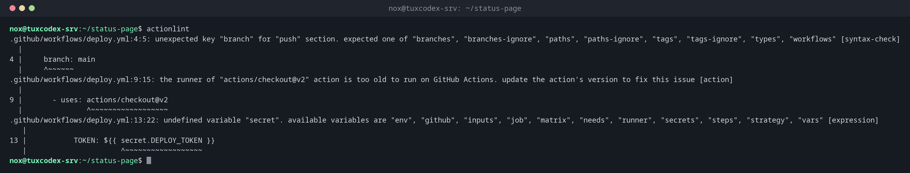

# actionlint

> Prüft Workflow-Dateien von GitHub Actions auf Fehler: falsche Schlüssel, unbekannte Variablen, veraltete Actions und Shell-Fehler in run-Schritten.



## Syntax

```bash
actionlint [OPTIONEN] [DATEI...]
```

## Optionen

| Option | Beschreibung |
|--------|--------------|
| (keine) | Alle Dateien in `.github/workflows/` des aktuellen Repositorys prüfen |
| `DATEI` | Nur diese Workflow-Dateien |
| `-oneline` | Eine Zeile pro Problem, für Skripte und Editoren |
| `-ignore MUSTER` | Meldungen ignorieren, die zum Muster passen |
| `-shellcheck=` | `run:`-Skripte nicht mit ShellCheck prüfen (das passiert, wenn es installiert ist) |
| `-color` | Farbige Ausgabe, auch in einer Pipe |

## Beispiele

**Alle Workflows des Repositorys prüfen:**

```bash
actionlint
```

```text
.github/workflows/deploy.yml:4:5: unexpected key "branch" for "push" section. expected one of "branches", "branches-ignore", "paths", "paths-ignore", "tags", "tags-ignore", "types", "workflows" [syntax-check]
  |
4 |     branch: main
  |     ^~~~~~~
.github/workflows/deploy.yml:9:15: the runner of "actions/checkout@v2" action is too old to run on GitHub Actions. update the action's version to fix this issue [action]
  |
9 |       - uses: actions/checkout@v2
  |               ^~~~~~~~~~~~~~~~~~~
.github/workflows/deploy.yml:13:22: undefined variable "secret". available variables are "env", "github", "inputs", "job", "matrix", "needs", "runner", "secrets", "steps", "strategy", "vars" [expression]
   |
13 |           TOKEN: ${{ secret.DEPLOY_TOKEN }}
   |                      ^~~~~~~~~~~~~~~~~~~
```

Drei Fehler, die GitHub erst nach dem Push melden würde oder gar nicht: `branch` statt `branches` heißt, dass der Workflow stillschweigend nie startet.

**Eine Zeile pro Problem:**

```bash
actionlint -oneline
```

```text
.github/workflows/deploy.yml:4:5: unexpected key "branch" for "push" section. expected one of "branches", "branches-ignore", "paths", "paths-ignore", "tags", "tags-ignore", "types", "workflows" [syntax-check]
.github/workflows/deploy.yml:9:15: the runner of "actions/checkout@v2" action is too old to run on GitHub Actions. update the action's version to fix this issue [action]
.github/workflows/deploy.yml:13:22: undefined variable "secret". available variables are "env", "github", "inputs", "job", "matrix", "needs", "runner", "secrets", "steps", "strategy", "vars" [expression]
```

**Keine Ausgabe heißt keine Probleme:**

```bash
actionlint .github/workflows/ci.yml && echo OK
```

```text
OK
```

## Wann brauche ich das?

- Vor jedem Push, der einen Workflow ändert
- Als pre-commit-Hook, damit kaputte Workflows gar nicht erst committet werden
- Um veraltete Actions zu finden, die GitHub bald nicht mehr ausführt

!!! tip "Nutzt ShellCheck automatisch"
    Ist [`shellcheck`](../17-bash-scripting/shellcheck.md) installiert, prüft actionlint auch
    den Shell-Code in jedem `run:`-Schritt, inklusive Quoting-Fehlern mit `${{ }}`.

## Verwandte Befehle

[act](act.md) · [yamllint](yamllint.md) · [pre-commit](pre-commit.md) · [shellcheck](../17-bash-scripting/shellcheck.md)
