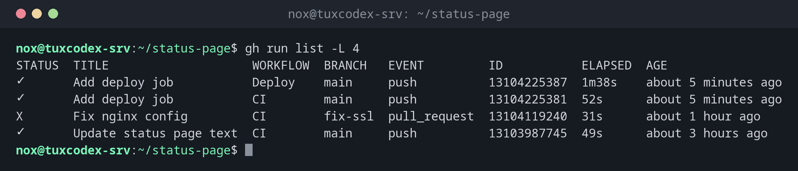

# gh run

> Lists, watches and restarts the runs of GitHub Actions workflows from the terminal.



## Syntax

```bash
gh run list | view | watch | rerun | cancel | download [RUN_ID] [OPTIONS]
```

## Options

| Option | Description |
|--------|-------------|
| `list` | The latest runs with status, workflow, branch and duration |
| `view [ID]` | Summary of a run: jobs, annotations, artifacts |
| `view --log-failed` | Only the log of the failed steps |
| `watch [ID]` | Follow a running run until it ends |
| `rerun [ID] --failed` | Run the failed jobs again |
| `cancel ID` | Stop a run |
| `download ID` | Download the artifacts of a run |
| `-R OWNER/REPO` | Another repository than the current one |
| `-w WORKFLOW`, `-b BRANCH`, `-L N` | With `list`: filter by workflow or branch, show N runs |

`gh` needs a login once: `gh auth login`.

## Examples

**The latest runs:**

```bash
gh run list -L 4
```

```text
STATUS  TITLE                    WORKFLOW  BRANCH   EVENT         ID           ELAPSED  AGE
✓       Add deploy job           Deploy    main     push          13104225387  1m38s    about 5 minutes ago
✓       Add deploy job           CI        main     push          13104225381  52s      about 5 minutes ago
X       Fix nginx config         CI        fix-ssl  pull_request  13104119240  31s      about 1 hour ago
✓       Update status page text  CI        main     push          13103987745  49s      about 3 hours ago
```

**Summary of a run:**

```bash
gh run view 13104225381
```

```text
✓ main CI · 13104225381
Triggered via push about 5 minutes ago

JOBS
✓ lint in 9s (ID 36457713245)
✓ build in 38s (ID 36457731902)

For more information about a job, try: gh run view --job=<job-id>
View this run on GitHub: https://github.com/nox/status-page/actions/runs/13104225381
```

**Show why the run failed:**

```bash
gh run view 13104119240 --log-failed
```

```text
lint  Check shell scripts  2026-10-26T08:41:13.4421337Z ##[group]Run shellcheck scripts/*.sh
lint  Check shell scripts  2026-10-26T08:41:13.4475012Z
lint  Check shell scripts  2026-10-26T08:41:13.5129843Z In scripts/deploy.sh line 2:
lint  Check shell scripts  2026-10-26T08:41:13.5130512Z rm -rf $TARGET/old
lint  Check shell scripts  2026-10-26T08:41:13.5131029Z        ^-----^ SC2086 (info): Double quote to prevent globbing and word splitting.
lint  Check shell scripts  2026-10-26T08:41:13.5287741Z ##[error]Process completed with exit code 1.
```

**Follow a running run:**

```bash
gh run watch
```

```text
✓ main CI · 13104225381
Triggered via push less than a minute ago

JOBS
✓ lint in 9s (ID 36457713245)
✓ build in 38s (ID 36457731902)

✓ Run CI (13104225381) completed with 'success'
```

**Run only the failed jobs again:**

```bash
gh run rerun 13104119240 --failed
```

```text
✓ Requested rerun (failed jobs) of run 13104119240
```

## When do I need it?

- Right after `git push`, to see whether the pipeline passes
- To read the error of a failed run without opening the browser
- To restart a run that failed because of a temporary problem

!!! tip "Push and watch in one line"
    `git push && sleep 5 && gh run watch` follows the run that the push started, and
    `gh run watch --exit-status` returns an error code if it fails, useful in scripts.

## Distribution differences

| | Debian | Ubuntu | RHEL | Arch |
|---|--------|--------|------|------|
| Install | `sudo apt install gh` | `sudo apt install gh` | repository `cli.github.com`, then `sudo dnf install gh` | `sudo pacman -S github-cli` |

## Related commands

[gh workflow](gh-workflow.md) · [gh secret](gh-secret.md) · [act](act.md) · [git push](../18-git/git-push.md)
