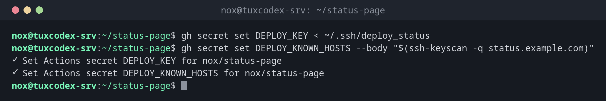

# gh secret

> Stores passwords and keys as GitHub secrets, which workflows can use without them ever being in the code.



## Syntax

```bash
gh secret set | list | delete NAME [OPTIONS]
```

## Options

| Option | Description |
|--------|-------------|
| `set NAME` | Set a secret; the value is read from the input |
| `set NAME < FILE` | Take the value from a file, such as an SSH key |
| `-b`, `--body VALUE` | Give the value directly (ends up in the shell history) |
| `-f`, `--env-file FILE` | Set all variables of a `.env` file at once |
| `-e`, `--env ENVIRONMENT` | Secret of a deployment environment, such as `production` |
| `list` | Names and dates of all secrets (never the values) |
| `delete NAME` | Delete a secret |

In a workflow, a secret is used as `${{ secrets.NAME }}`. `gh variable` works the same way for values that aren't secret.

## Examples

**Store the SSH key for the deployment:**

```bash
gh secret set DEPLOY_KEY < ~/.ssh/deploy_status
gh secret set DEPLOY_KNOWN_HOSTS --body "$(ssh-keyscan -q status.example.com)"
```

```text
✓ Set Actions secret DEPLOY_KEY for nox/status-page
✓ Set Actions secret DEPLOY_KNOWN_HOSTS for nox/status-page
```

**List the secrets:**

```bash
gh secret list
```

```text
NAME                UPDATED
DEPLOY_KEY          less than a minute ago
DEPLOY_KNOWN_HOSTS  less than a minute ago
REGISTRY_TOKEN      about 2 months ago
```

**Enter a password without the shell history:**

```bash
gh secret set REGISTRY_TOKEN
```

```text
? Paste your secret ********************************
✓ Set Actions secret REGISTRY_TOKEN for nox/status-page
```

**A secret for the production environment only:**

```bash
gh secret set DB_PASSWORD --env production < db_password.txt
```

```text
✓ Set Actions secret DB_PASSWORD for nox/status-page
```

## When do I need it?

- To give a deploy workflow the SSH key for your server
- To store API tokens for registries and cloud providers
- To rotate a password: set it again with the same name

!!! tip "Environments for production"
    Secrets of an environment like `production` can be protected with rules, for example
    a required approval. Then a pull request can't simply deploy to production.

!!! warning "Not readable, only replaceable"
    Nobody can read a secret back, neither in the web interface nor with `gh`. Keep the
    original in your password manager.

## Distribution differences

| | Debian | Ubuntu | RHEL | Arch |
|---|--------|--------|------|------|
| Install | `sudo apt install gh` | `sudo apt install gh` | repository `cli.github.com`, then `sudo dnf install gh` | `sudo pacman -S github-cli` |

## Related commands

[gh run](gh-run.md) · [gh workflow](gh-workflow.md) · [ssh-keygen](../12-ssh/ssh-keygen.md) · [ansible-vault](../21-ansible/ansible-vault.md)
