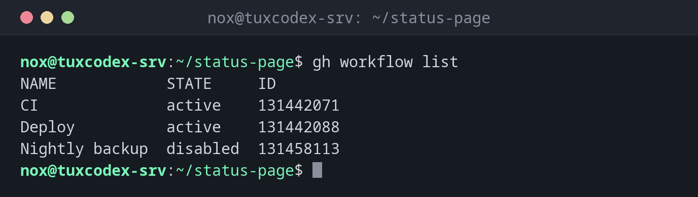

# gh workflow

> Listet die Workflows eines Repositorys auf, startet sie von Hand und schaltet sie an oder aus.



## Syntax

```bash
gh workflow list | view | run | enable | disable [WORKFLOW] [OPTIONEN]
```

## Optionen

| Option | Beschreibung |
|--------|--------------|
| `list` | Alle Workflows mit Zustand und ID |
| `view WORKFLOW` | Die letzten Läufe eines Workflows; `--yaml` zeigt die Datei |
| `run WORKFLOW` | Einen Workflow starten, der `workflow_dispatch` als Auslöser hat |
| `-f NAME=WERT` | Mit `run`: einen Eingabewert des Workflows setzen |
| `--ref BRANCH` | Mit `run`: auf diesem Branch ausführen |
| `disable`, `enable` | Einen Workflow ab- und wieder einschalten |

## Beispiele

**Die Workflows des Repositorys:**

```bash
gh workflow list
```

```text
NAME            STATE     ID
CI              active    131442071
Deploy          active    131442088
Nightly backup  disabled  131458113
```

**Ein Deployment von Hand starten:**

```bash
gh workflow run deploy.yml -f environment=staging
```

```text
✓ Created workflow_dispatch event for deploy.yml at main

To see runs for this workflow, try: gh run list --workflow="deploy.yml"
```

**Einen zeitgesteuerten Workflow wieder einschalten:**

```bash
gh workflow enable "Nightly backup"
```

```text
✓ Enabled Nightly backup
```

**Die letzten Läufe eines Workflows:**

```bash
gh workflow view deploy.yml
```

```text
Deploy - deploy.yml
ID: 131442088

Total runs 23
Recent runs
   TITLE           WORKFLOW  BRANCH  EVENT              ID
✓  Add deploy job  Deploy    main    push               13104225387
✓  Deploy          Deploy    main    workflow_dispatch  13098873420
✓  Raise PHP me…   Deploy    main    push               13091146518

To see more runs for this workflow, try: gh run list --workflow deploy.yml
To see the YAML for this workflow, try: gh workflow view deploy.yml --yaml
```

## Wann brauche ich das?

- Um ein Deployment oder eine Wartungsaufgabe von Hand zu starten
- Um einen zeitgesteuerten Workflow anzuhalten, etwa während einer Migration
- Um zu sehen, welche Workflows ein Repository hat

!!! tip "Einen Workflow von Hand startbar machen"
    Ergänze `workflow_dispatch:` unter `on:`. Dann lässt sich der Workflow mit
    `gh workflow run` oder dem Knopf in der Weboberfläche starten, auf Wunsch mit `inputs`.

!!! warning "Zeitgesteuerte Workflows schlafen ein"
    In öffentlichen Repositorys schaltet GitHub Workflows mit `schedule` nach 60 Tagen ohne
    Aktivität ab. `gh workflow enable` schaltet sie wieder ein.

## Unterschiede zwischen Distributionen

| | Debian | Ubuntu | RHEL | Arch |
|---|--------|--------|------|------|
| Installation | `sudo apt install gh` | `sudo apt install gh` | Repository `cli.github.com`, dann `sudo dnf install gh` | `sudo pacman -S github-cli` |

## Verwandte Befehle

[gh run](gh-run.md) · [gh secret](gh-secret.md) · [act](act.md)
