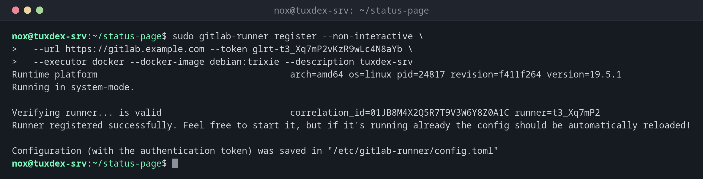

# gitlab-runner

> Runs the jobs of GitLab CI pipelines on your own server, in Docker containers or directly in a shell.



## Syntax

```bash
gitlab-runner register | list | verify | unregister | status | run [OPTIONS]
```

## Options

| Option | Description |
|--------|-------------|
| `register` | Connect the runner with a GitLab instance (with a runner token from the web interface) |
| `--url URL`, `--token TOKEN` | Address of GitLab and the runner token (`glrt-…`) |
| `--executor docker` | Run each job in a container (`shell` runs it directly on the host) |
| `--docker-image IMAGE` | Default image for jobs without `image:` |
| `--non-interactive` | Don't ask, take everything from the options |
| `list` | The registered runners from `/etc/gitlab-runner/config.toml` |
| `verify` | Check that the runners can still reach GitLab |
| `unregister --name NAME` | Remove a runner |

The runner itself runs as the systemd service `gitlab-runner`. Its configuration is in `/etc/gitlab-runner/config.toml`.

## Examples

**Register a runner with the Docker executor:**

```bash
sudo gitlab-runner register --non-interactive \
  --url https://gitlab.example.com --token glrt-t3_Xq7mP2vKzR9wLc4N8aYb \
  --executor docker --docker-image debian:trixie --description tuxdex-srv
```

```text
Runtime platform                                    arch=amd64 os=linux pid=24817 revision=f411f264 version=19.5.1
Running in system-mode.

Verifying runner... is valid                        correlation_id=01JB8M4X2Q5R7T9V3W6Y8Z0A1C runner=t3_Xq7mP2
Runner registered successfully. Feel free to start it, but if it's running already the config should be automatically reloaded!

Configuration (with the authentication token) was saved in "/etc/gitlab-runner/config.toml"
```

**The registered runners:**

```bash
sudo gitlab-runner list
```

```text
Runtime platform                                    arch=amd64 os=linux pid=24901 revision=f411f264 version=19.5.1
Listing configured runners                          ConfigFile=/etc/gitlab-runner/config.toml
tuxdex-srv                                          Executor=docker Token=glrt-t3_Xq7mP2vKzR9wLc4N8aYb URL=https://gitlab.example.com
```

**Check that the runner still reaches GitLab:**

```bash
sudo gitlab-runner verify
```

```text
Runtime platform                                    arch=amd64 os=linux pid=24937 revision=f411f264 version=19.5.1
Running in system-mode.

Verifying runner... is valid                        correlation_id=01JB8M6D4F8H1K3M5P7R9T2V4X runner=t3_Xq7mP2
```

**The runner as a service:**

```bash
systemctl is-active gitlab-runner
gitlab-runner --version | head -2
```

```text
active
Version:      19.5.1
Git revision: f411f264
```

## When do I need it?

- When jobs need access to your own network, for example to deploy to internal servers
- When the shared runners are too slow or the included minutes run out
- For jobs that need special hardware or large caches

!!! tip "Tags decide where a job runs"
    Register the runner with tags like `--tag-list deploy,internal` and give jobs
    `tags: [deploy]`. Then only these jobs end up on your runner.

!!! danger "The shell executor is root on your server"
    With `--executor shell`, every job runs directly on the host as user `gitlab-runner`, and
    anyone who may change `.gitlab-ci.yml` can run commands on your server. Prefer the
    `docker` executor and only use own runners for projects you trust.

## Distribution differences

| | Debian | Ubuntu | RHEL | Arch |
|---|--------|--------|------|------|
| Install | repository `packages.gitlab.com`, then `sudo apt install gitlab-runner` | repository `packages.gitlab.com`, then `sudo apt install gitlab-runner` | repository `packages.gitlab.com`, then `sudo dnf install gitlab-runner` | `sudo pacman -S gitlab-runner` |

## Related commands

[glab ci](glab-ci.md) · [docker run](../19-docker/docker-run.md) · [systemctl](../09-systemd/systemctl.md)
