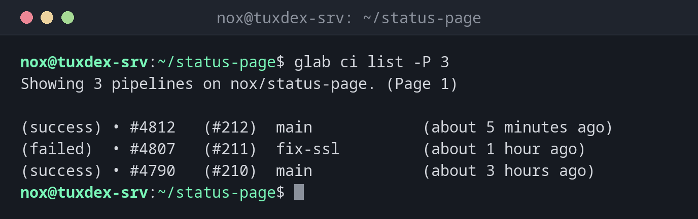

# glab ci

> Zeigt, startet und verfolgt GitLab-CI-Pipelines aus dem Terminal, das GitLab-Gegenstück zu gh run.



## Syntax

```bash
glab ci list | status | view | trace | run | retry | lint [OPTIONEN]
```

## Optionen

| Option | Beschreibung |
|--------|--------------|
| `list` | Die letzten Pipelines mit Status und Branch |
| `status` | Die Pipeline des aktuellen Branches mit allen Jobs |
| `view` | Interaktive Ansicht der Pipeline: Jobs öffnen, Logs lesen, neu starten |
| `trace [JOB]` | Das Log eines Jobs live verfolgen |
| `run` | Eine neue Pipeline starten, mit `--variables SCHLÜSSEL:WERT` |
| `retry JOB_ID` | Einen Job erneut ausführen |
| `lint` | Die `.gitlab-ci.yml` auf dem GitLab-Server prüfen |
| `-R GRUPPE/PROJEKT` | Ein anderes Projekt als das aktuelle |

Für die eigene GitLab-Instanz meldest du dich einmal mit `glab auth login --hostname gitlab.example.com` an.

## Beispiele

**Die letzten Pipelines:**

```bash
glab ci list -P 3
```

```text
Showing 3 pipelines on nox/status-page. (Page 1)

(success) • #4812   (#212)  main            (about 5 minutes ago)
(failed)  • #4807   (#211)  fix-ssl         (about 1 hour ago)
(success) • #4790   (#210)  main            (about 3 hours ago)
```

**Die Pipeline des aktuellen Branches:**

```bash
glab ci status
```

```text
(success) • 00m 41s  lint    lint
(success) • 01m 12s  build    build

https://gitlab.example.com/nox/status-page/-/pipelines/4812
SHA: 7f4bd5664044fdb7d0b2b8e97c16e5e42658a789
Pipeline state: success
```

**Die CI-Datei vor dem Push prüfen:**

```bash
glab ci lint
```

```text
Validating...
✓ CI/CD YAML is valid!
```

**Das Log eines Jobs verfolgen:**

```bash
glab ci trace lint
```

```text
Getting job trace...
Showing logs for lint job #18342
Running with gitlab-runner 19.5.1 (f411f264)
  on tuxdex-srv t3_Xq7mP2, system ID: s_4c1e9a2b7d3f
Preparing the "docker" executor
Using Docker executor with image debian:trixie ...
...
$ shellcheck scripts/*.sh
Cleaning up project directory and file based variables
Job succeeded
```

## Wann brauche ich das?

- Direkt nach einem Push, um die Pipeline zu verfolgen
- Um das Log eines gescheiterten Jobs im Terminal zu lesen
- Um die `.gitlab-ci.yml` zu prüfen, bevor du sie pushst

!!! tip "lint kennt deine Includes"
    `glab ci lint` prüft die Datei auf dem Server, mitsamt `include:`-Vorlagen und den
    Variablen des Projekts. Das findet mehr als eine reine YAML-Prüfung.

## Unterschiede zwischen Distributionen

| | Debian | Ubuntu | RHEL | Arch |
|---|--------|--------|------|------|
| Installation | `sudo apt install glab` | `sudo apt install glab` | `.rpm` aus den glab-Releases | `sudo pacman -S glab` |

## Verwandte Befehle

[gitlab-runner](gitlab-runner.md) · [gh run](gh-run.md) · [yamllint](yamllint.md)
