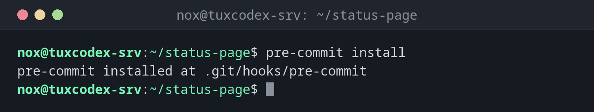

# pre-commit

> Führt Prüfungen wie Linter und Formatierer vor jedem Git-Commit automatisch aus, so wie sie im Projekt festgelegt sind.



## Syntax

```bash
pre-commit install | run [--all-files] | autoupdate | uninstall
```

## Optionen

| Option | Beschreibung |
|--------|--------------|
| `install` | Den Git-Hook in `.git/hooks/pre-commit` einrichten |
| `run` | Die Prüfungen auf den vorgemerkten Dateien ausführen |
| `run --all-files` | Sie auf allen Dateien ausführen, etwa nach dem Einrichten |
| `run HOOK_ID` | Nur eine Prüfung, etwa `shellcheck` |
| `autoupdate` | Die Versionen der Hooks in der Konfiguration aktualisieren |
| `uninstall` | Den Git-Hook entfernen |

Die Prüfungen stehen in `.pre-commit-config.yaml` im Repository, jede mit fester Version.

## Beispiele

**Den Hook in einem Repository einrichten:**

```bash
pre-commit install
```

```text
pre-commit installed at .git/hooks/pre-commit
```

**Die Konfiguration:**

```bash
cat .pre-commit-config.yaml
```

```text
repos:
  - repo: https://github.com/pre-commit/pre-commit-hooks
    rev: v5.0.0
    hooks:
      - id: trailing-whitespace
      - id: end-of-file-fixer
      - id: check-yaml
  - repo: https://github.com/shellcheck-py/shellcheck-py
    rev: v0.10.0.1
    hooks:
      - id: shellcheck
```

**Einmal alle Dateien prüfen:**

```bash
pre-commit run --all-files
```

```text
trim trailing whitespace.................................................Failed
- hook id: trailing-whitespace
- exit code: 1
- files were modified by this hook

Fixing scripts/deploy.sh

fix end of files.........................................................Passed
check yaml...............................................................Failed
- hook id: check-yaml
- exit code: 1

while constructing a mapping
  in "compose.yaml", line 3, column 5
found duplicate key "restart" with value "unless-stopped" (original value: "yes")
  in "compose.yaml", line 7, column 5

shellcheck...............................................................Failed
- hook id: shellcheck
- exit code: 1

In scripts/deploy.sh line 2:
rm -rf $TARGET/old
       ^-----^ SC2086 (info): Double quote to prevent globbing and word splitting.
```

Der erste Lauf lädt die Hooks nach `~/.cache/pre-commit`, das dauert einen Moment. Die Leerzeichen am Zeilenende wurden gleich korrigiert; die beiden anderen Probleme behebst du selbst.

**Ein Commit wird gestoppt:**

```bash
git commit -m "Add deploy script"
```

```text
trim trailing whitespace.................................................Passed
fix end of files.........................................................Passed
check yaml...............................................................Passed
shellcheck...............................................................Failed
- hook id: shellcheck
- exit code: 1

In scripts/deploy.sh line 2:
rm -rf $TARGET/old
       ^-----^ SC2086 (info): Double quote to prevent globbing and word splitting.

Did you mean:
rm -rf "$TARGET"/old
```

Der Commit wurde nicht angelegt. Korrigiere das Skript, füge es mit `git add` erneut hinzu und committe.

## Wann brauche ich das?

- Damit Fehler auf deinem Rechner auffallen statt in der Pipeline
- Um allen im Team mit einem Befehl dieselben Prüfungen zu geben
- Um Leerzeichen am Zeilenende und fehlende Zeilenenden automatisch zu korrigieren

!!! tip "Dieselben Prüfungen in der Pipeline"
    Führe `pre-commit run --all-files` auch als Schritt in der CI aus. Dann kommt nichts
    durch, das auf einem Rechner am Hook vorbeigegangen ist.

!!! warning "Hooks lassen sich überspringen"
    `git commit --no-verify` überspringt alle Hooks. pre-commit ist eine Hilfe, keine
    Garantie, deshalb sollte die Pipeline ebenfalls prüfen.

## Unterschiede zwischen Distributionen

| | Debian | Ubuntu | RHEL | Arch |
|---|--------|--------|------|------|
| Installation | `sudo apt install pre-commit` | `sudo apt install pre-commit` | `pipx install pre-commit` | `sudo pacman -S pre-commit` |

## Verwandte Befehle

[yamllint](yamllint.md) · [actionlint](actionlint.md) · [git commit](../18-git/git-commit.md) · [shellcheck](../17-bash-scripting/shellcheck.md)
