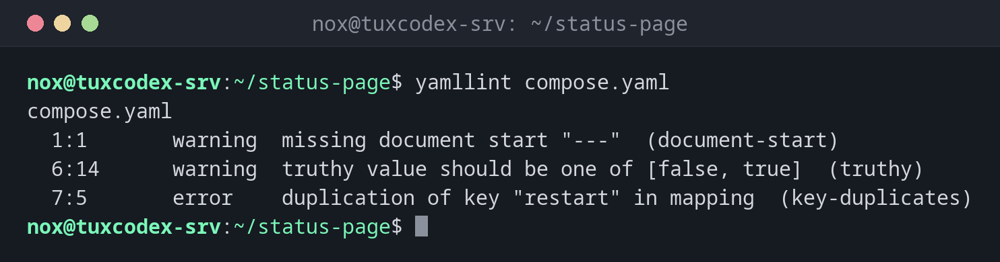

# yamllint

> Checks YAML files for syntax errors, duplicate keys and style problems, whether pipeline, Compose file or playbook.



## Syntax

```bash
yamllint [OPTIONS] FILE|DIRECTORY...
```

## Options

| Option | Description |
|--------|-------------|
| `FILE`, `.` | Files or whole directories |
| `-f parsable` | One line per problem |
| `-d relaxed` | Less strict rules, without style warnings like the missing `---` |
| `-c FILE` | Own configuration (otherwise `.yamllint` in the project) |
| `-s`, `--strict` | Also fail on warnings |

## Examples

**Check a Compose file:**

```bash
yamllint compose.yaml
```

```text
compose.yaml
  1:1       warning  missing document start "---"  (document-start)
  6:14      warning  truthy value should be one of [false, true]  (truthy)
  7:5       error    duplication of key "restart" in mapping  (key-duplicates)
```

**The file with the errors:**

```bash
cat -n compose.yaml
```

```text
     1  services:
     2    web:
     3      image: nginx:1.28
     4      ports:
     5        - "8080:80"
     6      restart: yes
     7      restart: unless-stopped
```

**One line per problem:**

```bash
yamllint -f parsable compose.yaml
```

```text
compose.yaml:1:1: [warning] missing document start "---" (document-start)
compose.yaml:6:14: [warning] truthy value should be one of [false, true] (truthy)
compose.yaml:7:5: [error] duplication of key "restart" in mapping (key-duplicates)
```

**Less strict, only real problems:**

```bash
yamllint -d relaxed .gitlab-ci.yml && echo OK
```

```text
OK
```

## When do I need it?

- For every YAML file before it goes into production: CI pipelines, `compose.yaml`, Kubernetes manifests, Ansible
- To find duplicate keys, where YAML silently uses only the last value
- In pipelines and pre-commit hooks, together with more specific linters

!!! tip "A .yamllint for the project"
    `extends: default` plus `rules: {document-start: disable, line-length: {max: 120}}` in
    `.yamllint` keeps the useful checks and drops the noisy ones.

!!! warning "Duplicate keys are dangerous"
    In the example below, `restart:` appears twice. Most programs silently take the last
    value, so the configuration doesn't do what the first line says. yamllint reports this as
    an error.

## Distribution differences

| | Debian | Ubuntu | RHEL | Arch |
|---|--------|--------|------|------|
| Install | `sudo apt install yamllint` | `sudo apt install yamllint` | `sudo dnf install yamllint` (EPEL) | `sudo pacman -S yamllint` |

## Related commands

[actionlint](actionlint.md) · [pre-commit](pre-commit.md) · [ansible-lint](../21-ansible/ansible-lint.md) · [kubectl apply](../20-kubernetes/kubectl-apply.md)
