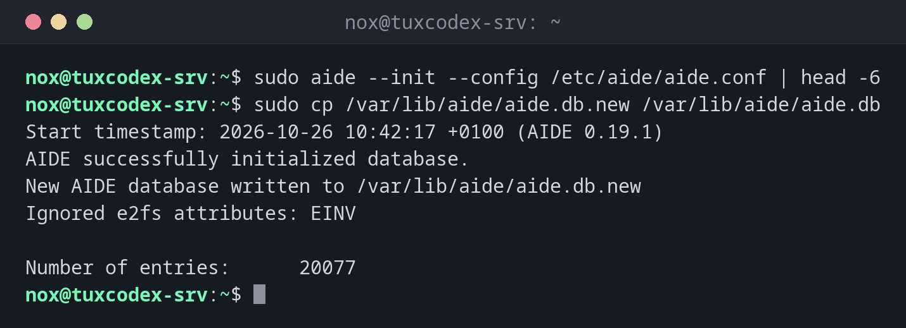

# aide

> Speichert Prüfsummen und Attribute wichtiger Dateien in einer Datenbank und meldet später jede Datei, die hinzugekommen, verschwunden oder verändert ist.



## Syntax

```bash
aide --init | --check | --update [--config DATEI]
```

## Optionen

| Option | Beschreibung |
|--------|--------------|
| `--init` | Eine neue Datenbank anlegen (`aide.db.new`) |
| `--check` | Die Dateien mit der Datenbank vergleichen |
| `--update` | Prüfen und eine neue Datenbank mit dem aktuellen Stand schreiben |
| `--config DATEI` | Konfiguration, unter Debian `/etc/aide/aide.conf` |
| `--limit PFAD` | Nur diesen Pfad prüfen |

Unter Debian und Ubuntu legt `aideinit` die erste Datenbank an, und `/etc/cron.daily/dailyaidecheck` prüft täglich. Nach `--init` kopierst du `aide.db.new` nach `aide.db`.

## Beispiele

**Die Datenbank anlegen:**

```bash
sudo aide --init --config /etc/aide/aide.conf | head -6
sudo cp /var/lib/aide/aide.db.new /var/lib/aide/aide.db
```

```text
Start timestamp: 2026-10-26 10:42:17 +0100 (AIDE 0.19.1)
AIDE successfully initialized database.
New AIDE database written to /var/lib/aide/aide.db.new
Ignored e2fs attributes: EINV

Number of entries:      20077
```

**Das System prüfen:**

```bash
sudo aide --check --config /etc/aide/aide.conf | head -24
```

```text
Start timestamp: 2026-10-27 03:15:02 +0100 (AIDE 0.19.1)
AIDE found differences between database and filesystem!!
Ignored e2fs attributes: EINV

Summary:
  Total number of entries:      20078
  Added entries:                1
  Removed entries:              0
  Changed entries:              2

---------------------------------------------------
Added entries:
---------------------------------------------------

f++++++++++++++++++: /usr/local/bin/sysupdate

---------------------------------------------------
Changed entries:
---------------------------------------------------

f >.... mc..H.. .  : /etc/ssh/ssh_config
d >.... mc.. .. .  : /usr/local/bin
```

Ein neues Programm in `/usr/local/bin`, das niemand installiert hat, und eine geänderte SSH-Konfiguration: genau dafür ist AIDE da. `cat /usr/local/bin/sysupdate` zeigt, was es tut.

**Die Details einer geänderten Datei:**

```bash
sudo aide --check --config /etc/aide/aide.conf | grep -A6 '^File: /etc/ssh/ssh_config'
```

```text
File: /etc/ssh/ssh_config
 Size      : 1650                             | 1670
 Mtime     : 2026-08-13 10:00:00 +0200        | 2026-10-27 01:12:44 +0100
 Ctime     : 2026-08-13 10:00:00 +0200        | 2026-10-27 01:12:44 +0100
 SHA256    : RMkYV/NLHsaOJG68utZsS5OAtBw0kMcZ | zm2eKuUrRACjhxL0sGrltdYuiGeT8gW4
             vf1mlrp7QLU=                     | xMN9K5VYv90=
```

## Wann brauche ich das?

- Um zu bemerken, wenn jemand Systemprogramme oder Konfigurationsdateien ändert
- Für Compliance-Vorgaben wie PCI DSS, die eine Überwachung der Dateiintegrität verlangen
- Nach einem Vorfall, um genau zu sehen, welche Dateien verändert wurden

!!! tip "Eine Kopie der Datenbank woanders aufbewahren"
    Ein Angreifer mit Root-Rechten kann auch die AIDE-Datenbank aktualisieren. Kopiere
    `aide.db` nach jedem Update auf einen anderen Rechner oder ein schreibgeschütztes Medium.

!!! warning "Nach Updates: --update"
    Jedes Paket-Update ändert Dateien, die AIDE überwacht. Führe nach Updates
    `aide --update` aus, prüf den Bericht und übernimm die neue Datenbank. Sonst gehen die
    echten Änderungen im Rauschen unter.

## Unterschiede zwischen Distributionen

| | Debian | Ubuntu | RHEL | Arch |
|---|--------|--------|------|------|
| Installation | `sudo apt install aide` | `sudo apt install aide` | `sudo dnf install aide` | AUR |

## Verwandte Befehle

[debsums](debsums.md) · [rkhunter](rkhunter.md) · [lynis](lynis.md) · [sha256sum](../14-archives/sha256sum.md)
