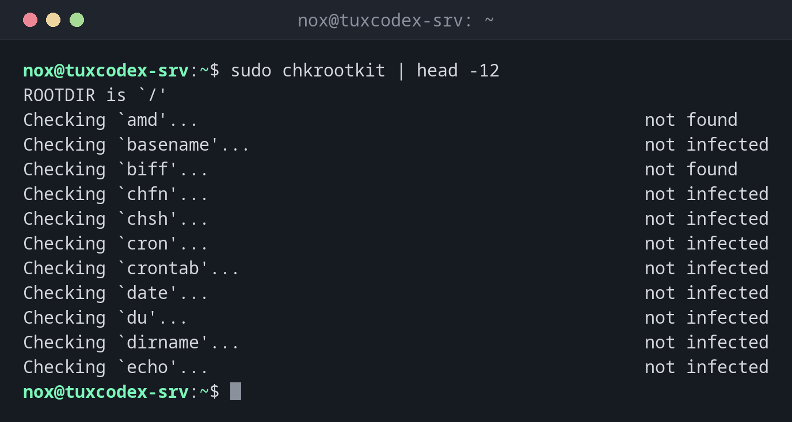

# chkrootkit

> Checks system programs and the system for signs of known rootkits; a second opinion next to rkhunter.



## Syntax

```bash
chkrootkit [OPTIONS] [TEST...]
```

## Options

| Option | Description |
|--------|-------------|
| (none) | Run all tests and show each result |
| `-q` | Quiet: only show findings |
| `-x` | Expert mode with more details |
| `-r DIRECTORY` | Check a mounted system, for example from a rescue system |
| `-l` | List the available tests |
| `TEST` | Only these tests, such as `sshd` or `chkdirs` |

## Examples

**Run all tests:**

```bash
sudo chkrootkit | head -12
```

```text
ROOTDIR is `/'
Checking `amd'...                                           not found
Checking `basename'...                                      not infected
Checking `biff'...                                          not found
Checking `chfn'...                                          not infected
Checking `chsh'...                                          not infected
Checking `cron'...                                          not infected
Checking `crontab'...                                       not infected
Checking `date'...                                          not infected
Checking `du'...                                            not infected
Checking `dirname'...                                       not infected
Checking `echo'...                                          not infected
```

**Only show findings:**

```bash
sudo chkrootkit -q
```

```text
WARNING: The following suspicious files and directories were found:
/usr/lib/ruby/vendor_ruby/rubygems/ssl_certs/.document [From Debian package: ruby-rubygems]
/usr/lib/ruby/vendor_ruby/rubygems/vendor/net-http/.document [From Debian package: ruby-rubygems]
/usr/lib/ruby/vendor_ruby/rubygems/vendor/uri/.document [From Debian package: ruby-rubygems]
```

Files from a Debian package, so harmless. A real finding would be a hidden file without a package, for example in `/dev` or `/usr/lib`.

**Check a mounted disk from a rescue system:**

```bash
sudo mount /dev/sda2 /mnt
sudo chkrootkit -q -r /mnt
```

```text
ROOTDIR is `/mnt/'
```

## When do I need it?

- As a second check next to rkhunter, because the two find different things
- To check the disk of a suspicious server from a rescue system with `-r`
- As a nightly cron job with `-q`, so that a mail only arrives on findings

!!! tip "Check from outside with -r"
    Boot a rescue system, mount the server's disk under `/mnt` and run
    `chkrootkit -r /mnt`. Then a rootkit on the server can't hide from the check.

!!! warning "Read the findings"
    Hidden files like `.document` from Debian packages are reported as suspicious, but are
    harmless. chkrootkit even names the package they come from.

## Distribution differences

| | Debian | Ubuntu | RHEL | Arch |
|---|--------|--------|------|------|
| Install | `sudo apt install chkrootkit` | `sudo apt install chkrootkit` | from source (chkrootkit.org) | AUR |

## Related commands

[rkhunter](rkhunter.md) · [clamscan](clamscan.md) · [aide](aide.md) · [mount](../13-disks-storage/mount.md)
