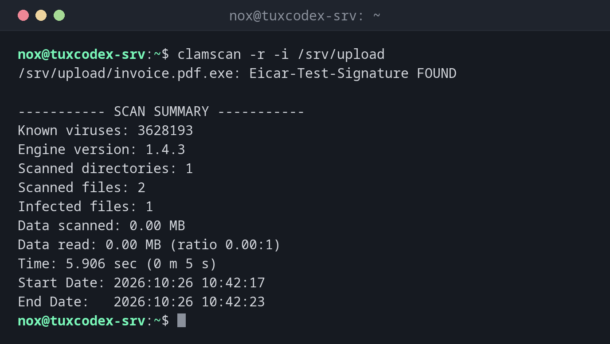

# clamscan

> Scans files and directories for viruses and malware with the open source scanner ClamAV.



## Syntax

```bash
clamscan [OPTIONS] FILE|DIRECTORY...
```

## Options

| Option | Description |
|--------|-------------|
| `-r`, `--recursive` | Also scan subdirectories |
| `-i`, `--infected` | Only list infected files |
| `--move=DIRECTORY` | Move infected files to a quarantine directory |
| `--remove` | Delete infected files (careful) |
| `--exclude-dir=PATTERN` | Skip directories |
| `-l FILE` | Write a log |

The signatures are updated by `freshclam`, on Debian and Ubuntu automatically by the service `clamav-freshclam`. For many scans, the daemon `clamd` with `clamdscan` is much faster.

## Examples

**Scan an upload directory:**

```bash
clamscan -r -i /srv/upload
```

```text
/srv/upload/invoice.pdf.exe: Eicar-Test-Signature FOUND

----------- SCAN SUMMARY -----------
Known viruses: 3628193
Engine version: 1.4.3
Scanned directories: 1
Scanned files: 2
Infected files: 1
Data scanned: 0.00 MB
Data read: 0.00 MB (ratio 0.00:1)
Time: 5.906 sec (0 m 5 s)
Start Date: 2026:10:26 10:42:17
End Date:   2026:10:26 10:42:23
```

Here it's the EICAR test file. With `-i`, clean files aren't listed.

**Move findings to quarantine:**

```bash
sudo mkdir -p /var/quarantine
clamscan -r -i --move=/var/quarantine /srv/upload | head -2
```

```text
/srv/upload/invoice.pdf.exe: Eicar-Test-Signature FOUND
/srv/upload/invoice.pdf.exe: moved to '/var/quarantine/invoice.pdf.exe'
```

**Check the signature updates:**

```bash
systemctl is-active clamav-freshclam
sudo tail -2 /var/log/clamav/freshclam.log
```

```text
active
Mon Oct 26 10:12:01 2026 -> daily.cld database is up-to-date (version: 27801, sigs: 2074391, f-level: 90, builder: svc.clamav-publisher)
Mon Oct 26 10:12:01 2026 -> main.cvd database is up-to-date (version: 63, sigs: 3287027, f-level: 90, builder: tomjudge)
```

## When do I need it?

- For upload directories of web applications and file shares
- For mail servers and servers that handle files from Windows clients
- As a nightly scan of selected directories

!!! tip "Test with EICAR"
    The EICAR test file is a harmless string that every virus scanner recognizes. With it, you
    can test that scanning and alerting work without real malware.

!!! warning "Not a scan of the whole server"
    A full scan of `/` takes long and reads every file. On Linux servers, ClamAV is mainly
    useful for files that come from outside: uploads, mail, shares.

## Distribution differences

| | Debian | Ubuntu | RHEL | Arch |
|---|--------|--------|------|------|
| Install | `sudo apt install clamav` | `sudo apt install clamav` | `sudo dnf install clamav clamav-update` (EPEL) | `sudo pacman -S clamav` |

## Related commands

[rkhunter](rkhunter.md) · [chkrootkit](chkrootkit.md) · [find](../02-navigation/find.md)
