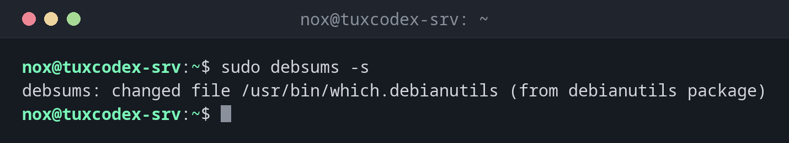

# debsums

> Unter Debian und Ubuntu: vergleicht installierte Dateien mit den Prüfsummen ihrer Pakete und meldet veränderte Dateien.



## Syntax

```bash
debsums [OPTIONEN] [PAKET...]
```

## Optionen

| Option | Beschreibung |
|--------|--------------|
| (keine) | Alle Pakete prüfen und jede Datei zeigen |
| `-s`, `--silent` | Nur Fehler melden |
| `-c`, `--changed` | Nur geänderte Dateien auflisten |
| `-e`, `--config` | Nur Konfigurationsdateien prüfen |
| `-a`, `--all` | Auch Konfigurationsdateien prüfen (standardmäßig übersprungen) |
| `PAKET` | Nur diese Pakete |

Unter RHEL erledigt `rpm -Va` dasselbe, unter Arch `pacman -Qkk`.

## Beispiele

**Nur geänderte Dateien melden:**

```bash
sudo debsums -s
```

```text
debsums: changed file /usr/bin/which.debianutils (from debianutils package)
```

Ein Systemprogramm, das vom Paket abweicht. Wenn du es nicht selbst geändert hast, ist das ein ernster Fund.

**Von Hand geänderte Konfigurationsdateien:**

```bash
sudo debsums -ce
```

```text
/etc/ssh/sshd_config
/etc/nginx/nginx.conf
/etc/default/rkhunter
```

**Ein einzelnes Paket prüfen:**

```bash
debsums coreutils | head -4
```

```text
/usr/bin/[                                                                    OK
/usr/bin/arch                                                                 OK
/usr/bin/b2sum                                                                OK
/usr/bin/base32                                                               OK
```

**Dasselbe unter RHEL:**

```bash
sudo rpm -Va | grep -v '^.......T'
```

```text
S.5....T.  c /etc/ssh/sshd_config
S.5....T.    /usr/bin/which
```

`S` Größe, `5` Prüfsumme, `T` Zeit geändert; `c` kennzeichnet Konfigurationsdateien.

## Wann brauche ich das?

- Um zu prüfen, ob Systemprogramme außerhalb des Paketmanagers verändert wurden
- Nach einem Vorfall, als schnelle Prüfung ohne vorbereitete Datenbank
- Um Konfigurationsdateien zu finden, die von Hand geändert wurden (`-ce`)

!!! tip "Keine Vorbereitung nötig"
    Anders als AIDE braucht debsums keine eigene Datenbank: Die Prüfsummen kommen mit den
    Paketen. Das macht es zur ersten schnellen Prüfung auf einem Server, den du gerade
    übernommen hast.

!!! warning "Gleiches System, gleiches Risiko"
    Ein Rootkit mit Root-Rechten kann auch die Prüfsummendateien in `/var/lib/dpkg/info/`
    fälschen. Für eine verlässliche Prüfung vergleiche mit frisch geladenen Paketen
    (`debsums --generate`) oder prüfe von einem Rettungssystem aus.

## Unterschiede zwischen Distributionen

| | Debian | Ubuntu | RHEL | Arch |
|---|--------|--------|------|------|
| Befehl | `debsums` | `debsums` | `rpm -Va` (eingebaut) | `pacman -Qkk` (eingebaut) |

## Verwandte Befehle

[aide](aide.md) · [rkhunter](rkhunter.md) · [dpkg](../10-packages/dpkg.md) · [rpm](../10-packages/rpm.md)
